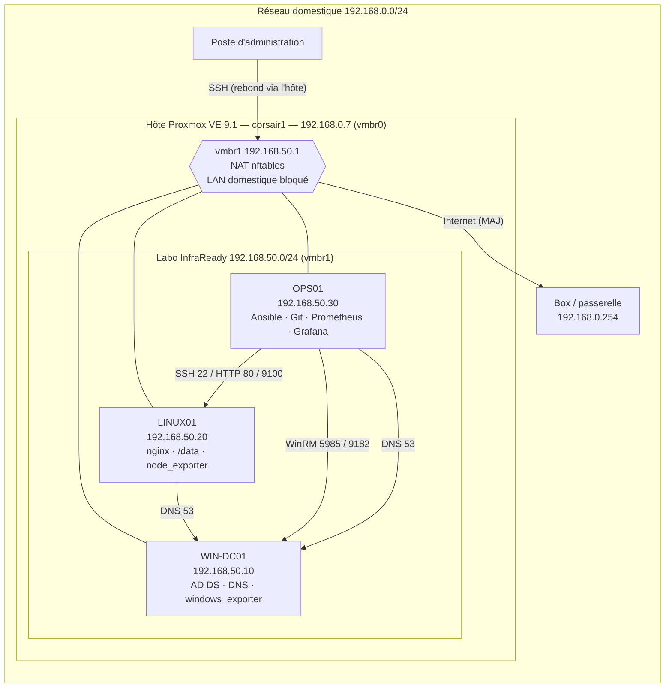

# InfraReady — Dossier technique

> [!info] À propos de ce dossier
> Rempli avec les configurations et preuves **réellement obtenues** sur le laboratoire. Chaque résultat renvoie à une preuve `P-xx` stockée dans `docs/preuves/` (sorties de commandes horodatées, captures). Aucun secret n'apparaît dans ce dossier ni dans le dépôt.

| Champ | Valeur |
| --- | --- |
| **Binôme** | [Nom 1] / [Nom 2] |
| **Classe** | [Groupe] |
| **Lien GitHub** | https://github.com/Nothypaa/InfraReady (privé) |
| **Date / version** | 19/10/2026 — v0.2 |
| **Statut du projet** | En cours — phases A à D réalisées, E à H à faire |

---

## 1. Présentation et périmètre

- **Contexte :** InfraReady souhaite standardiser ses configurations, automatiser l'administration et superviser ses serveurs Linux/Windows.
- **Besoin / contraintes :**
	- Laboratoire de 3 serveurs (1 Windows Server 2025, 2 Ubuntu Server 24.04 LTS), isolé du réseau personnel.
	- Administration reproductible (Ansible), supervision (Prometheus/Grafana), dépôt versionné et validé par CI.
	- Aucune donnée réelle : comptes, groupes et données sont fictifs.
- **Répartition du binôme :** [À compléter]
- **Conventions de preuves :** numérotation par phase — A = P-0x, B = P-1x, C = P-2x, D = P-3x, E = P-4x, F = P-5x, G = P-6x, H = P-7x. Les sorties sont capturées automatiquement avec l'heure et la commande exécutée.

---

## 2. Architecture et inventaire



| Machine | VMID | OS | Rôle | Ressources réelles | IP |
| --- | --- | --- | --- | --- | --- |
| WIN-DC01 | 100 | Windows Server 2025 Standard Evaluation (Desktop Experience) | AD DS / DNS | 4 vCPU (2×2) · 6 Go · 50 Go (IDE), UEFI + TPM 2.0, carte e1000e | 192.168.50.10 |
| LINUX01 | 101 | Ubuntu Server 24.04.5 LTS | Services Linux (nginx), stockage | 4 vCPU (2×2) · 4 Go · 30 Go + **10 Go de test** (`/data`) | 192.168.50.20 |
| OPS01 | 102 | Ubuntu Server 24.04.5 LTS | Ansible, Git, Prometheus, Grafana | 8 vCPU (2×4) · 6 Go · 50 Go | 192.168.50.30 |

| Paramètre | Valeur |
| --- | --- |
| **Hyperviseur / réseau** | Proxmox VE 9.1.1 (au lieu de VMware Workstation — voir écarts). Pont dédié `vmbr1` sans carte physique, NAT vers `vmbr0`. |
| **Sous-réseau validé** | 192.168.50.0/24 — passerelle 192.168.50.1 (hôte Proxmox) |
| **Domaine / DNS** | `infraready.test` (NetBIOS `INFRAREADY`) — DNS = 192.168.50.10, redirecteurs 1.1.1.1 / 9.9.9.9 |
| **Adaptations matérielles** | Hôte 16 cœurs / ~46 Go RAM : pas de réduction nécessaire. Disques sur pool ZFS `pool-ssd`. |

**Flux autorisés / pare-feu**

| Source | Destination | Port | Justification | Contrôle |
| --- | --- | --- | --- | --- |
| Labo 192.168.50.0/24 | Internet | tous (sortant) | Mises à jour, téléchargements | NAT nftables sur l'hôte |
| Labo 192.168.50.0/24 | Réseau domestique 192.168.0.0/24 | — | **Interdit** (isolation) | nftables `forward` : `ct state new drop` |
| Labo (dont rebond hôte .1) | LINUX01 | 22/tcp | Administration SSH | UFW (clé uniquement, mot de passe désactivé) |
| Labo | LINUX01 | 80/tcp | Service web | UFW |
| OPS01 (.30) | LINUX01 | 9100/tcp | node_exporter | UFW (OPS01 seul) |
| Labo | WIN-DC01 | 5985/tcp | WinRM (Ansible) | Pare-feu Windows limité à 192.168.50.0/24 |
| OPS01 (.30) | WIN-DC01 | 9182/tcp | windows_exporter | Pare-feu Windows (OPS01 seul) |
| Labo | WIN-DC01 | 53, 88, 389, 445… | DNS / Kerberos / LDAP / SMB | Règles AD par défaut de Windows |
| Labo | WIN-DC01 | ICMP echo | Tests de connectivité | Pare-feu Windows limité au labo |

---

## 3. Phase A — Installation et réseau

> [!abstract] Objectif
> Mettre en service les VM, les noms, les adresses et la connectivité du laboratoire.

**Responsable :** [Nom] · **Dates :** 19/10/2026 · **Statut :** Fait

### Travaux réalisés / checklist

- [x] Créer WIN-DC01, LINUX01 et OPS01 (Proxmox VE, VMID 100 à 102).
- [x] Installer Windows Server 2025 et Ubuntu Server 24.04 LTS (installations automatiques).
- [x] Configurer les noms d'hôtes et les adresses IP fixes.
- [x] Configurer le réseau virtuel et vérifier l'isolation.
- [x] Tester les communications IP entre VM.
- [x] Configurer et tester la résolution DNS du domaine.
- [x] Actualiser le schéma d'architecture selon le déploiement réel.

### Procédure et configuration

**Réseau du labo (hôte Proxmox)** — sauvegarde préalable de `/etc/network/interfaces` (`interfaces.bak-infraready`), puis ajout du pont `vmbr1` (fichier `lab/proxmox/vmbr1.interfaces`) et des règles `lab/proxmox/infraready-nat.nft` :
- `masquerade` des adresses 192.168.50.0/24 sortant par `vmbr0` (accès Internet) ;
- `drop` de toute **nouvelle** connexion du labo vers 192.168.0.0/24 (isolation du réseau domestique).

L'hôte n'ayant pas `iptables`, la NAT est écrite en **nftables** dans une table dédiée (`infraready_nat`), chargée/supprimée par `post-up`/`post-down` du pont.

**Installations automatiques** (aucune saisie manuelle) :

| VM | Méthode | Points clés |
| --- | --- | --- |
| LINUX01 / OPS01 | ISO `ubuntu-24.04.5-live-server-amd64.iso` (SHA-256 vérifié) + 2ᵉ lecteur « CIDATA » contenant un fichier **autoinstall** (`lab/autoinstall-user-data.yml.tpl`) | Hostname, IP fixe, LVM sur tout le disque, clavier fr, compte `infraadmin` (mot de passe haché SHA-512), SSH par clé uniquement, `qemu-guest-agent`, MAJ de sécurité pendant l'installation |
| WIN-DC01 | ISO Windows Server 2025 Eval + 2ᵉ lecteur contenant `autounattend.xml` (`lab/autounattend.xml.tpl`) | Image n°2 (Standard, Desktop Experience) identifiée dans `install.wim`, partitionnement UEFI/GPT, nom `WIN-DC01`, IP fixe par adresse MAC, fuseau Romance, clavier fr, WinRM + ping autorisés **depuis le labo uniquement** |

Les fichiers de réponse contenant de vrais mots de passe ont été **supprimés du stockage Proxmox** après installation ; le dépôt ne contient que des modèles avec `__PLACEHOLDERS__`.

**DNS** : après création du domaine (phase B), les VM Linux pointent sur le DC (`/etc/netplan/50-cloud-init.yaml` : `nameservers 192.168.50.10`, `search infraready.test`, sauvegarde dans `/root/`). La configuration réseau de cloud-init est désactivée par l'installeur (`90-installer-network.cfg`) : le changement est persistant.

**Commandes réellement utilisées** : `qm set / qm start / qm sendkey / qm snapshot`, `nft list table`, `ip -br addr`, `ip route`, `ping`, `curl`, `resolvectl dns|domain|query`, `getent ahostsv4`, `Get-NetIPConfiguration`, `Resolve-DnsName`, `Test-Connection`.

![[P-03-win-dc01-installe-server-manager.png|600]]

### Tests et preuves

| Vérification | Attendu | Résultat observé | Preuve |
| --- | --- | --- | --- |
| Démarrage des trois VM | Trois VM fonctionnelles | 3 VM `running`, snapshot `s01_installation_ok` sur chacune ; Windows installé en ~10 min, Ubuntu en ~6 min | [P-01](docs/preuves/P-01-proxmox-vms-et-reseau.txt), [P-03](docs/preuves/P-03-win-dc01-installe-server-manager.png) |
| Adressage IP | IP conforme au plan validé | .10 / .20 / .30, passerelle 192.168.50.1, toutes sur `vmbr1` | [P-02](docs/preuves/P-02-linux01-ip-connectivite-isolation.txt), [P-02b](docs/preuves/P-02b-ops01-ip-connectivite-isolation.txt), [P-04c](docs/preuves/P-04c-win-dc01-ip-dns.txt) |
| Connectivité croisée | Communication autorisée fonctionnelle | Ping OK entre les 3 VM et vers la passerelle ; Internet OK (HTTP 200 archive.ubuntu.com) | [P-02](docs/preuves/P-02-linux01-ip-connectivite-isolation.txt), [P-02b](docs/preuves/P-02b-ops01-ip-connectivite-isolation.txt), [P-04c](docs/preuves/P-04c-win-dc01-ip-dns.txt) |
| Isolation | Labo sans accès au réseau domestique | 192.168.0.254 **bloqué** depuis le labo, mais répond depuis l'hôte → blocage dû à la règle nftables | [P-02](docs/preuves/P-02-linux01-ip-connectivite-isolation.txt) |
| Résolution DNS | Enregistrements / domaine résolus | A, PTR et SRV `_ldap._tcp.dc._msdcs` résolus depuis les 2 VM Linux et le DC ; nom court `win-dc01` résolu grâce au domaine de recherche | [P-04](docs/preuves/P-04-linux01-resolution-dns-domaine.txt), [P-04b](docs/preuves/P-04b-ops01-resolution-dns-domaine.txt), [P-04c](docs/preuves/P-04c-win-dc01-ip-dns.txt) |

### Difficultés / décision / retour arrière

| Problème | Cause | Correction | Résultat |
| --- | --- | --- | --- |
| Les VM Linux avaient l'ISO Ubuntu **26.04** | Mauvaise ISO attachée à la création | Téléchargement d'Ubuntu 24.04.5 sur l'hôte, SHA-256 vérifié, ISO remplacée | Conforme au sujet |
| Carte réseau `e1000` sur WIN-DC01 | Pilote non garanti sur Windows Server 2025 | Passage en `e1000e` (même adresse MAC) | Réseau fonctionnel dès l'installation |
| L'installeur Ubuntu demande « Continue with autoinstall? » | Mot-clé `autoinstall` absent de la ligne de commande du noyau | Réponse `yes` envoyée par `qm sendkey` | Installation sans autre intervention |
| Pas d'`iptables` sur l'hôte Proxmox 9 | Système basé sur nftables | Règles écrites en nftables, table dédiée | NAT + isolation fonctionnelles |
| Le DC n'avait pas d'enregistrement PTR | Zone inverse créée **après** la promotion du DC | Ajout du PTR du DC dans `windows_base.yml` | PTR .10 résolu ([P-35](docs/preuves/P-35-playbook-windows-correction-ptr-dc.txt)) |
| Mot de passe `sudo` de l'hôte visible dans l'en-tête d'une preuve | Le script de capture recopiait la commande complète | Preuve nettoyée, script corrigé (affiche `sudo`), vérification systématique avant chaque commit | Aucun secret dans le dépôt |

Retour arrière disponible : snapshot `s01_installation_ok` (3 VM) et `interfaces.bak-infraready` sur l'hôte.

---

## 4. Phase B — Administration Windows

> [!abstract] Objectif
> Rendre l'annuaire et le DNS opérationnels, documenter comptes, groupes et journaux.

**Responsable :** [Nom] · **Dates :** 19/10/2026 · **Statut :** Fait

### Travaux réalisés / checklist

- [x] Installer AD DS sur WIN-DC01.
- [x] Créer le domaine de laboratoire et configurer DNS.
- [x] Créer au moins deux groupes de test.
- [x] Créer plusieurs comptes de test et les affecter aux groupes.
- [x] Décrire les droits et accès attribués.
- [x] Vérifier les journaux et événements Windows pertinents.
- [x] Démontrer l'état du domaine et les tests DNS.

### Procédure et configuration

Snapshot `s02_avant_adds` pris avant toute modification. Les actions sont lancées depuis OPS01 via WinRM (Ansible) :

1. **AD DS + forêt** — playbook `ansible/playbooks/windows_adds.yml` (équivalent PowerShell indiqué en tête du fichier : `Install-WindowsFeature AD-Domain-Services`, `Install-ADDSForest`) :
	- forêt `infraready.test`, NetBIOS `INFRAREADY`, niveau fonctionnel **Windows2025Domain / Windows2025Forest** ;
	- DNS intégré à AD, redirecteurs 1.1.1.1 et 9.9.9.9, le DC utilise son propre DNS ;
	- source de temps NTP `fr.pool.ntp.org` (le DC racine fournit l'heure au domaine — indispensable pour Kerberos) ;
	- mot de passe DSRM fourni depuis le **vault Ansible chiffré**.
2. **Objets de l'annuaire** — script `scripts/ad-objets.ps1` (rejouable, mot de passe initial passé en paramètre depuis le vault) :

| OU | Groupe (global, sécurité) | Membres | Rôle fictif |
| --- | --- | --- | --- |
| `OU=Groupes,OU=InfraReady` | `GG_Support_IT` | j.martin, s.bernard | Support informatique |
| `OU=Groupes,OU=InfraReady` | `GG_Comptabilite` | l.petit, t.moreau | Service comptabilité |

Comptes dans `OU=Utilisateurs,OU=InfraReady`, activés, **changement de mot de passe obligatoire à la première connexion**. OU protégées contre la suppression accidentelle.

**Droits et accès attribués** (appliqués par `windows_base.yml`, phase D) :

| Ressource | GG_Comptabilite | GG_Support_IT | Autres utilisateurs |
| --- | --- | --- | --- |
| Partage SMB `\\WIN-DC01\Compta` | Modification (Change) | Lecture | Aucun accès (partage masqué de l'énumération) |
| NTFS `C:\Partages\Comptabilite` | Modify | ReadAndExecute | `BUILTIN\Users` retiré, héritage désactivé |

Principe : moindre privilège — le support peut consulter pour dépanner, seule la comptabilité modifie.

**Outils réellement utilisés** : `Get-ADDomain`, `Get-ADForest`, `Get-ADUser`, `Get-ADGroupMember`, `Resolve-DnsName`, `Get-DnsServerZone`, `Get-DnsServerForwarder`, `dcdiag`, `w32tm`, `Get-WinEvent`, Server Manager (capture P-03).

### Tests et preuves

| Vérification | Attendu | Résultat observé | Preuve |
| --- | --- | --- | --- |
| Domaine AD | Domaine créé et accessible | `infraready.test` / `INFRAREADY`, DC `WIN-DC01.infraready.test`, catalogue global ; dcdiag : 10 tests fonctionnels réussis (Connectivity, Advertising, SysVolCheck, MachineAccount, NetLogons, RidManager, Services, DNS ×2, FsmoCheck) | [P-10](docs/preuves/P-10-adds-installation-foret.txt), [P-12](docs/preuves/P-12-domaine-dns-verifications.txt), [P-12b](docs/preuves/P-12b-dcdiag-tests-fonctionnels-ntp.txt) |
| Comptes et groupes | Au moins 2 groupes + plusieurs comptes présents | 2 groupes, 4 comptes, appartenances conformes | [P-11](docs/preuves/P-11-ad-ou-groupes-comptes.txt), [P-12](docs/preuves/P-12-domaine-dns-verifications.txt) |
| DNS interne | Résolution du domaine validée | A `infraready.test` et `win-dc01` → .10, SRV LDAP, résolution externe via redirecteurs, zones intégrées AD en mise à jour sécurisée | [P-12](docs/preuves/P-12-domaine-dns-verifications.txt), [P-04c](docs/preuves/P-04c-win-dc01-ip-dns.txt) |
| Journaux Windows | Événements vérifiés et interprétés | voir interprétation ci-dessous | [P-13](docs/preuves/P-13-journaux-windows-ad.txt) |

**Interprétation des journaux (P-13)**

| Journal / ID | Observation | Interprétation |
| --- | --- | --- |
| System 1074 — 15:10:51 | Redémarrage demandé par `shutdown.exe` | Redémarrage de fin de promotion du DC |
| Directory Service 1000 — 15:12:07 | « AD DS startup complete » | Annuaire démarré après promotion |
| DNS Server 2 et 4 — 15:12:38 | Serveur DNS démarré, zones chargées | DNS intégré AD opérationnel |
| Security 4727 / 4720 / 4728 — 15:11:58 | Groupes, comptes et appartenances créés | Comptes et groupes **intégrés** créés avec la forêt |
| Security 4727 / 4720 / 4728 — 15:14:34-35 | 2 groupes, 4 comptes, 4 ajouts aux groupes | Exécution de `ad-objets.ps1` (traçabilité de nos actions) |
| dcdiag `DFSREvent`, `SystemLog` en échec | Erreurs RID pool, SYSVOL non partagé, à 15:12:37 | Événements **transitoires du premier démarrage** d'une nouvelle forêt ; les tests fonctionnels associés (RidManager, SysVolCheck) passent ensuite |

### Difficultés / décision / retour arrière

| Problème | Cause | Correction | Résultat |
| --- | --- | --- | --- |
| 1er lancement de `windows_adds.yml` en échec | Paramètre `reboot_timeout` inexistant dans `microsoft.ad` 1.4.1 (version fournie par Ubuntu) | Paramètre retiré (délai par défaut suffisant) | Forêt créée au 2ᵉ lancement ([P-10a](docs/preuves/P-10a-adds-premier-essai-echec-reboot_timeout.txt) → [P-10](docs/preuves/P-10-adds-installation-foret.txt)) |
| DC synchronisé sur sa propre horloge (« Local CMOS Clock ») | Configuration par défaut | NTP externe configuré dans le playbook | Stratum 2, synchronisé ([P-12b](docs/preuves/P-12b-dcdiag-tests-fonctionnels-ntp.txt)) |
| Événements horodatés **23:52** (dans le futur) | **Hypothèse** : saut d'horloge pendant la promotion, avant toute synchronisation NTP | NTP configuré ; heure du DC vérifiée identique à OPS01 | Plus de dérive observée |
| `win_powershell` refuse le paramètre `path` | Option absente d'`ansible.windows` 2.2.0 | Contenu du script passé par `lookup('file', …)` | Scripts exécutés à distance |

Retour arrière disponible : snapshots `s02_avant_adds` et `s03_avant_ansible` de WIN-DC01.

---

## 5. Phase C — Administration Linux

> [!abstract] Objectif
> Gérer identités, permissions, services, stockage, mises à jour et journaux sur Ubuntu.

**Responsable :** [Nom] · **Dates :** 19/10/2026 · **Statut :** Fait

### Travaux réalisés / checklist

- [x] Créer et configurer des utilisateurs et groupes Linux.
- [x] Attribuer et vérifier les permissions.
- [x] Installer un service applicatif simple (nginx).
- [x] Administrer et contrôler les processus et services.
- [x] Ajouter un disque virtuel de test, créer un système de fichiers.
- [x] Configurer et documenter le montage du disque.
- [x] Mettre Ubuntu à jour selon une procédure contrôlée.
- [x] Lire et analyser des journaux système.

### Procédure et configuration

Réalisée **manuellement** sur LINUX01 (commandes conservées dans l'en-tête de chaque preuve), puis reprise dans Ansible en phase D.

**Identités et permissions**

| Compte | Groupes | Usage |
| --- | --- | --- |
| alice, bruno | `webadmins` | Mettent à jour le site web |
| chloe | `auditeurs`, `systemd-journal` | Consulte les journaux et rapports, sans droit d'écriture |
| ansible | — (sudo sans mot de passe, clé SSH) | Compte de service pour l'automatisation |

Les comptes du labo sont **verrouillés** (`passwd -S` → `L`) : aucun mot de passe utilisable, accès via `sudo -u` uniquement.

| Dossier | Propriétaire | Mode | Effet |
| --- | --- | --- | --- |
| `/var/www/infraready` | root:webadmins | `2775` (setgid) | webadmins écrivent, les fichiers héritent du groupe ; les autres lisent |
| `/data/rapports` | root:auditeurs | `2750` | auditeurs lisent, aucun accès pour les autres |

**Service** : nginx 1.24, site `infraready` (vhost dédié, journaux séparés `infraready_access.log` / `infraready_error.log`), site par défaut désactivé, `nginx -t` avant chaque rechargement.

**Stockage** : disque de 10 Go ajouté **à chaud** (`qm set 101 --scsi1 pool-ssd:10,serial=INFRA-DATA01`), identifié par son **numéro de série** (`/dev/disk/by-id/scsi-SQEMU_QEMU_HARDDISK_INFRA-DATA01` → `/dev/sdb`). Formatage uniquement si les 5 contrôles sont conformes (taille 10G, aucune signature, aucune partition, non monté, différent du disque système), sinon arrêt automatique. Système de fichiers ext4 (label `DATA`), montage `/data` **par UUID** avec `nofail` dans `/etc/fstab`.

**Mise à jour contrôlée** : (1) snapshot `s02_avant_maj_c` ; (2) pré-contrôles disque et services ; (3) `apt-get update` + simulation `apt-get -s upgrade` ; (4) `apt-get upgrade` (jamais de suppression de paquet), conservation des fichiers de configuration locaux ; (5) contrôle de `/var/log/apt/history.log` ; (6) vérification de `/var/run/reboot-required`.

**Commandes réellement utilisées** : `groupadd`, `useradd`, `id`, `getent`, `passwd -S`, `chmod`, `chown`, `ls -l`, `sudo -u`, `nginx -t`, `systemctl status|stop|start|restart|is-enabled`, `ss -tlnp`, `ps`, `pgrep`, `curl`, `lsblk`, `wipefs -n`, `mkfs.ext4`, `blkid`, `findmnt`, `mount -a`, `df -hT`, `apt-get`, `journalctl`, `uptime`, `free`.

### Tests et preuves

| Vérification | Attendu | Résultat observé | Preuve |
| --- | --- | --- | --- |
| Comptes / permissions | Droits conformes au besoin | alice écrit dans le site ✔, chloe refusée ✔ ; chloe lit le journal ✔, alice non ✔ ; chloe lit `/data/rapports` ✔, alice refusée ✔ | [P-20](docs/preuves/P-20-linux01-comptes-groupes-permissions.txt), [P-22](docs/preuves/P-22-linux01-disque-test-montage.txt) |
| Service applicatif | Service accessible et fonctionnel | `nginx -t` OK, actif et activé au démarrage, port 80 en écoute, HTTP 200 depuis OPS01 ; stop → HTTP 000, start → 200, restart → nouveau PID maître | [P-21](docs/preuves/P-21-linux01-service-nginx-processus.txt) |
| Stockage de test | Disque formaté sur la bonne cible et monté | Contrôles conformes, `/dev/sdb` ext4 9.8G monté sur `/data` par UUID, remontage via fstab réussi | [P-22](docs/preuves/P-22-linux01-disque-test-montage.txt) |
| Maintenance et logs | Mises à jour et journaux vérifiés | 20 paquets mis à jour (code retour 0), pas de redémarrage requis ; tentative SSH « pirate » et requête 404 retrouvées dans les journaux ; aucune erreur ni unité en échec | [P-23](docs/preuves/P-23-linux01-mise-a-jour-controlee.txt), [P-24](docs/preuves/P-24-linux01-analyse-journaux.txt) |

**Analyse des journaux (P-24)** : `sshd` enregistre `Invalid user pirate from 192.168.50.30` (connexion refusée avant authentification) ; nginx trace `GET /admin.php … 404` depuis OPS01 ; le noyau trace l'arrivée à chaud de `sdb` (10.7 GB) ; `journalctl -p err -b` vide ; `sudo` trace chaque commande privilégiée avec l'utilisateur à l'origine.

### Difficultés / décision / retour arrière

| Problème | Cause | Correction | Résultat |
| --- | --- | --- | --- |
| Premiers contrôles « avant formatage » exécutés sur un chemin inexistant | Nom `/dev/disk/by-id/…` deviné au lieu d'être lu | Aucun formatage n'avait lieu dans ce premier script ; lecture du vrai nom (`ls -l /dev/disk/by-id`) et ajout d'un **arrêt automatique** si un contrôle n'est pas conforme | Formatage sur la bonne cible uniquement |

Retour arrière disponible : snapshot `s02_avant_maj_c` (inclut le disque de test), sauvegarde netplan dans `/root/`.

---

## 6. Phase D — Automatisation avec Ansible

> [!abstract] Objectif
> Fournir des playbooks Linux et Windows reproductibles et idéalement idempotents.

**Responsable :** [Nom] · **Dates :** 19/10/2026 · **Statut :** Fait

### Travaux réalisés / checklist

- [x] Installer et préparer Ansible sur OPS01.
- [x] Créer l'inventaire et les variables nécessaires.
- [x] Configurer/tester SSH pour Linux et WinRM pour Windows.
- [x] Créer au moins un playbook Linux.
- [x] Créer au moins un playbook Windows.
- [x] Automatiser plusieurs tâches de configuration.
- [x] Contrôler la bonne exécution et traiter les erreurs.
- [x] Rejouer les playbooks et évaluer l'idempotence.
- [x] Documenter commandes, prérequis, dépendances et résultats.

### Procédure et configuration

**Prérequis sur OPS01** : `apt install ansible python3-winrm git jq` → ansible-core 2.16.3 avec les collections `ansible.windows` 2.2.0, `ansible.posix` 1.5.4, `community.general` 8.3.0, `community.windows` 2.1.0, `microsoft.ad` 1.4.1 (liste dans `ansible/requirements.yml`).

**Compte de service** : `scripts/bootstrap-ansible-user.sh` crée l'utilisateur `ansible` (clé ed25519 générée sur OPS01, copiée sur LINUX01, sudo sans mot de passe validé par `visudo -c`).

**Fichiers**

| Fichier | Contenu |
| --- | --- |
| `ansible/ansible.cfg` | Inventaire, journal `~/infraready-logs/ansible.log`, minutage des tâches, fichier de mot de passe du vault (hors dépôt) |
| `inventory/hosts.yml` | Groupes `linux` (linux01, ops01 en connexion locale), `windows` (win-dc01), `monitoring` |
| `group_vars/all.yml` | Sous-réseau, domaine, IP du DC et d'OPS01, fuseau horaire |
| `group_vars/linux/vars.yml` | SSH avec l'utilisateur `ansible` + clé, `become` |
| `group_vars/windows/vars.yml` | WinRM HTTP 5985, NTLM (message chiffré), mot de passe lu dans le vault |
| `group_vars/windows/vault.yml` | **Chiffré AES256** (Ansible Vault) : mots de passe Administrateur, DSRM, initial des comptes AD |

**Playbooks**

| Playbook | Cible | Actions automatisées | Vérifications intégrées |
| --- | --- | --- | --- |
| `windows_adds.yml` | WIN-DC01 | Rôle AD DS, forêt, NTP, redirecteurs et client DNS | Attente des services AD, état du domaine |
| `linux_base.yml` | LINUX01 | Fuseau, paquets, groupes/comptes, droits du site, template nginx + handler de rechargement, montage `/data` par UUID, droits `/data/rapports`, **pare-feu UFW** (22 et 80 depuis le labo, 9100 depuis OPS01, refus par défaut), node_exporter | HTTP 200 sur le site, `/metrics` de node_exporter |
| `windows_base.yml` | WIN-DC01 | OU, groupes, comptes (`no_log`), dossier + ACL NTFS + partage SMB, zone inverse, enregistrements A/PTR, windows_exporter **0.31.8** (MSI), règle de pare-feu 9182 réservée à OPS01 | Services NTDS, DNS, Netlogon, kdc, windows_exporter démarrés (`assert`), `/metrics` joignable depuis OPS01 |

**Commandes réellement utilisées** : `ansible --version`, `ansible-inventory --graph`, `ansible linux -m ping`, `ansible windows -m win_ping`, `ansible-playbook playbooks/<nom>.yml [--diff]`, lancées deux fois de suite.

### Tests et preuves

| Vérification | Attendu | Résultat observé | Preuve |
| --- | --- | --- | --- |
| Inventaire Ansible | Hôtes Linux et Windows décrits | 3 hôtes dans 3 groupes | [P-30](docs/preuves/P-30-ansible-inventaire-connexions.txt) |
| Connexions | Linux SSH et Windows transport validés | `ping: pong` (linux01, ops01) et `win_ping: pong` (win-dc01) | [P-30](docs/preuves/P-30-ansible-inventaire-connexions.txt) |
| Playbook Linux | Exécution sans erreur bloquante | ok=22 changed=10 failed=0 | [P-31](docs/preuves/P-31-playbook-linux-1er-passage.txt) |
| Playbook Windows | Exécution sans erreur bloquante | ok=21 changed=12 failed=0 | [P-33](docs/preuves/P-33-playbook-windows-1er-passage.txt) |
| Second passage | État stable / changements expliqués | **Linux changed=0**, **Windows changed=0** | [P-32](docs/preuves/P-32-playbook-linux-2e-passage-idempotence.txt), [P-34](docs/preuves/P-34-playbook-windows-2e-passage-idempotence.txt) |

**Changements du 1er passage Linux expliqués** : paquets absents (node_exporter, ufw, acl, htop), description du compte chloe différente de la saisie manuelle, page et vhost remplacés par les templates, ligne fstab réécrite au format Ansible, 4 règles UFW nouvelles, rechargement nginx (handler). **Windows** : partage, ACL, DNS et exporter n'existaient pas ; OU, groupes et comptes déjà créés en phase B → `ok` sans changement.

### Difficultés / décision / retour arrière

| Problème | Cause | Correction | Résultat |
| --- | --- | --- | --- |
| windows_exporter 0.31.9 disponible | Version publiée 9 jours plus tôt | Choix de **0.31.8** (stable depuis 3 mois) | Version figée, surchargeable par variable d'environnement |
| L'option MSI `ADDLOCAL=FirewallException` ouvre 9182 à tout le monde | Comportement de l'installeur | Option retirée, règle dédiée limitée à OPS01 | Port 9182 exposé à OPS01 seulement |
| PTR du DC absent (vu en phase A) | Zone inverse créée après la promotion | PTR ajouté au playbook ; relance (changed=1) puis idempotence (changed=0) | [P-35](docs/preuves/P-35-playbook-windows-correction-ptr-dc.txt), [P-34](docs/preuves/P-34-playbook-windows-2e-passage-idempotence.txt) |

Retour arrière disponible : snapshot `s03_avant_ansible` (WIN-DC01 et LINUX01).

---

## 7. Phase E — Maintenance et mises à jour

> [!abstract] Objectif
> Formaliser et tester une maintenance sûre et traçable sur les deux OS.

**Responsable :** [Nom] · **Dates :** [Date(s)] · **Statut :** À faire

### Travaux réalisés / checklist

- [ ] Écrire une procédure de maintenance standard.
- [ ] Automatiser les mises à jour Linux.
- [ ] Documenter et tester les mises à jour Windows.
- [ ] Vérifier l'espace disque et l'état des services.
- [ ] Documenter les précautions avant redémarrage et changement majeur.
- [ ] Conserver une trace des exécutions et résultats.

### Procédure et configuration

[À compléter : pré-contrôles, snapshot, procédure et fenêtre de maintenance, ordre des opérations, retour arrière.]

[Commandes et interfaces réellement utilisées : `apt`, PowerShell/Windows Update, `df -h`, `Get-Volume`, `systemctl`, `Get-Service`…]

### Tests et preuves

| Vérification | Attendu | Résultat observé | Preuve |
| --- | --- | --- | --- |
| Mise à jour Linux | Procédure automatisée vérifiable | [Résultat réel] | [P-4x] |
| Mise à jour Windows | Procédure exécutée et documentée | [Résultat réel] | [P-4x] |
| Capacité disque | État relevé et interprété | [Résultat réel] | [P-4x] |
| État des services | Services critiques contrôlés | [Résultat réel] | [P-4x] |

### Difficultés / décision / retour arrière

[À compléter]

---

## 8. Phase F — Supervision Prometheus et Grafana

> [!abstract] Objectif
> Collecter et visualiser les métriques réelles des serveurs et présenter une alerte.

**Responsable :** [Nom] · **Dates :** [Date(s)] · **Statut :** En cours (exporters déployés en phase D, configuration Prometheus écrite)

### Travaux réalisés / checklist

- [ ] Installer et configurer Prometheus sur OPS01.
- [x] Configurer Node Exporter pour LINUX01 (installé par `linux_base.yml`, port 9100 ouvert pour OPS01).
- [x] Configurer Windows Exporter pour WIN-DC01 (0.31.8, port 9182 ouvert pour OPS01).
- [ ] Vérifier les cibles et données reçues par Prometheus.
- [ ] Installer/configurer Grafana avec Prometheus comme source.
- [ ] Créer un dashboard avec CPU, mémoire, stockage, disponibilité.
- [ ] Démontrer un seuil ou une alerte simple.
- [ ] Documenter origine, ports et cheminement des métriques.

### Procédure et configuration

Fichiers déjà écrits : `monitoring/prometheus/prometheus.yml` (jobs `prometheus`, `linux`, `windows`, label `host`), `monitoring/prometheus/rules/infraready.rules.yml` (alertes InstanceDown, CpuEleve, MemoireElevee, DisquePresquePlein), provisioning Grafana (source `Prometheus` + dossier de dashboards).

[À compléter : installation, cibles, nom du dashboard, captures, démonstration de l'alerte.]

### Tests et preuves

| Vérification | Attendu | Résultat observé | Preuve |
| --- | --- | --- | --- |
| Collecte Linux | Métriques de LINUX01 disponibles | [Résultat réel] | [P-5x] |
| Collecte Windows | Métriques de WIN-DC01 disponibles | [Résultat réel] | [P-5x] |
| Source Grafana | Prometheus connecté | [Résultat réel] | [P-5x] |
| Dashboard | CPU, RAM, disque et disponibilité visibles | [Résultat réel] | [P-5x] |
| Seuil / alerte | Démonstration vérifiable | [Résultat réel] | [P-5x] |

### Difficultés / décision / retour arrière

[À compléter]

---

## 9. Phase G — GitHub et intégration continue

> [!abstract] Objectif
> Versionner les livrables et valider le dépôt automatiquement via GitHub Actions.

**Responsable :** [Nom] · **Dates :** 19/10/2026 · **Statut :** En cours (bloqué : droit `workflow` du jeton GitHub)

### Travaux réalisés / checklist

- [x] Créer un dépôt GitHub adapté au binôme (privé, collaborateur `jolanallen` invité en écriture).
- [x] Organiser playbooks, scripts, variables, monitoring et docs (voir arborescence en annexe).
- [ ] Utiliser des commits descriptifs des deux membres.
- [x] Créer `.github/workflows/validation.yml`.
- [x] Déclencher des validations à chaque push ou pull request (`on: push, pull_request, workflow_dispatch`).
- [x] Inclure des contrôles pertinents : fichiers attendus, `yamllint`, `ansible-playbook --syntax-check`, `ansible-lint`, `promtool check config`, JSON du dashboard, **gitleaks** sur tout l'historique, vault obligatoirement chiffré.
- [ ] Fournir une preuve d'exécution réussie du workflow.
- [x] Contrôler l'absence de secrets en clair (recherche des vrais mots de passe dans le dépôt avant chaque commit, `.gitignore`, vault chiffré).

### Procédure et configuration

- **Dépôt** : https://github.com/Nothypaa/InfraReady — branche `main`.
- **Jobs** : `fichiers`, `yaml-ansible`, `monitoring`, `secrets` (voir `.github/workflows/validation.yml`).

[À compléter : lien du run GitHub Actions réussi.]

### Tests et preuves

| Vérification | Attendu | Résultat observé | Preuve |
| --- | --- | --- | --- |
| Dépôt et arborescence | Fichiers attendus présents | Voir arborescence (annexe) | [Lien](https://github.com/Nothypaa/InfraReady) |
| Contributions | Contributions du binôme traçables | [Résultat réel] | [Lien] |
| Workflow automatique | Push / PR déclenche la validation | [Résultat réel] | [P-6x] |
| Pipeline vert | Exécution terminée avec succès | [Résultat réel] | [P-6x] |

### Difficultés / décision / retour arrière

| Problème | Cause | Correction | Résultat |
| --- | --- | --- | --- |
| `git push` refusé : « refusing to allow an OAuth App to create or update workflow … without `workflow` scope » | Le jeton GitHub CLI n'a pas le droit `workflow`, obligatoire pour modifier `.github/workflows/` | `gh auth refresh -h github.com -s workflow` | En attente |

---

## 10. Phase H — Diagnostic d'incident

> [!abstract] Objectif
> Reproduire un incident simple, contrôlé, réversible et justifier le retour à la normale.

**Responsable :** [Nom] · **Dates :** [Date(s)] · **Statut :** À faire

### Travaux réalisés / checklist

- [ ] Choisir un incident du labo (service, DNS, stockage, exporter, playbook…).
- [ ] Décrire le symptôme initial et l'heure du constat.
- [ ] Consigner les tests effectués et les journaux consultés.
- [ ] Identifier une cause confirmée ou une hypothèse explicitement signalée.
- [ ] Appliquer et documenter une correction ciblée.
- [ ] Rejouer les tests pour confirmer le retour à la normale.
- [ ] Joindre les preuves et préparer un rapport d'incident distinct.

### Procédure et configuration

[À compléter : date, incident choisi, systèmes concernés, impact, chronologie et cause / hypothèse.]

[À compléter : commandes, journaux, captures avant et après, changement réalisé.]

### Tests et preuves

| Vérification | Attendu | Résultat observé | Preuve |
| --- | --- | --- | --- |
| Reproduction | Symptôme observé et documenté | [Résultat réel] | [P-7x] |
| Diagnostic | Hypothèse vérifiée / cause expliquée | [Résultat réel] | [P-7x] |
| Correction | Modification clairement décrite | [Résultat réel] | [P-7x] |
| Retour à la normale | Test identique à nouveau réussi | [Résultat réel] | [P-7x] |

### Difficultés / décision / retour arrière

[À compléter]

---

## 11. Sécurité et limites d'intervention

- [x] VM du laboratoire uniquement, aucun système externe — seules les VM 100 à 102 ont été modifiées ; les autres VM de l'hôte n'ont pas été touchées.
- [x] Cibles contrôlées avant formatage / partitionnement — disques système vérifiés vides avant installation ; disque de test identifié par numéro de série + 5 contrôles avec arrêt automatique.
- [x] Snapshots avant changements majeurs — `s01_installation_ok`, `s02_avant_adds`, `s02_avant_maj_c`, `s03_avant_ansible`.
- [x] Moindre privilège — comptes Linux verrouillés, droits par groupe, chloe lit sans écrire, support IT en lecture seule sur le partage Compta, compte `ansible` dédié.
- [x] Ports limités au strict besoin — UFW sur LINUX01 (refus par défaut), WinRM/ICMP limités au labo, exporters limités à OPS01, labo isolé du réseau domestique.
- [x] Aucun secret en clair dans Git ou dans ce dossier — vault AES256, modèles avec `__PLACEHOLDERS__`, fichiers de réponse supprimés après usage, recherche des vrais secrets avant chaque commit, gitleaks dans la CI.
- [x] Playbooks testés avant exécution large — un hôte par playbook, snapshot préalable, second passage pour vérifier la stabilité.
- [x] Changements perturbateurs documentés — redémarrage de promotion du DC, modification réseau de l'hôte (sauvegarde `interfaces.bak-infraready`), changement DNS des VM Linux (sauvegarde netplan).
- [x] Fonctionnalités non réalisées signalées — voir section 13.

**Limites connues** : WinRM en HTTP (5985) avec chiffrement NTLM du message, mais sans certificat TLS ; OPS01 sans pare-feu local pour l'instant ; mot de passe `sudo` de l'hôte Proxmox faible et à changer en fin de projet.

---

## 12. Recette finale et matrice des preuves

### Recette finale

| Phase | Validation finale | État | Preuve |
| --- | --- | --- | --- |
| A | VM / IP / réseau / DNS | ✅ Validé | P-01 à P-04c |
| B | AD DS / groupes / comptes / DNS | ✅ Validé | P-10 à P-13 |
| C | Permissions / service / stockage / logs | ✅ Validé | P-20 à P-24 |
| D | Playbooks Linux & Windows / idempotence | ✅ Validé | P-30 à P-35 |
| E | Mises à jour / maintenance | ⏳ À faire | — |
| F | Exporters / dashboard / alerte | 🔶 En cours (exporters OK) | P-33 |
| G | Workflow GitHub Actions réussi | 🔶 En cours (push bloqué) | — |
| H | Incident corrigé / retour normal | ⏳ À faire | — |

### Matrice des preuves

| ID | Date | Test ou capture | Fichier |
| --- | --- | --- | --- |
| P-01 | 19/10/2026 | VM Proxmox, snapshots, pont vmbr1, règles nftables | [P-01](docs/preuves/P-01-proxmox-vms-et-reseau.txt) |
| P-02 | 19/10/2026 | LINUX01 : IP, connectivité, Internet, isolation + contre-test | [P-02](docs/preuves/P-02-linux01-ip-connectivite-isolation.txt) |
| P-02b | 19/10/2026 | OPS01 : IP, connectivité, Internet, isolation | [P-02b](docs/preuves/P-02b-ops01-ip-connectivite-isolation.txt) |
| P-03 | 19/10/2026 | Capture : WIN-DC01 installé, Server Manager | [P-03](docs/preuves/P-03-win-dc01-installe-server-manager.png) |
| P-04 | 19/10/2026 | LINUX01 : DNS du domaine (A, PTR, SRV) | [P-04](docs/preuves/P-04-linux01-resolution-dns-domaine.txt) |
| P-04b | 19/10/2026 | OPS01 : DNS du domaine (A, PTR, SRV) | [P-04b](docs/preuves/P-04b-ops01-resolution-dns-domaine.txt) |
| P-04c | 19/10/2026 | WIN-DC01 : IP, ping et résolution des serveurs | [P-04c](docs/preuves/P-04c-win-dc01-ip-dns.txt) |
| P-10a | 19/10/2026 | 1er essai de promotion en échec (`reboot_timeout`) | [P-10a](docs/preuves/P-10a-adds-premier-essai-echec-reboot_timeout.txt) |
| P-10 | 19/10/2026 | Installation AD DS + forêt infraready.test | [P-10](docs/preuves/P-10-adds-installation-foret.txt) |
| P-11 | 19/10/2026 | OU, groupes, comptes AD | [P-11](docs/preuves/P-11-ad-ou-groupes-comptes.txt) |
| P-12 | 19/10/2026 | État du domaine, comptes, DNS, zones, dcdiag | [P-12](docs/preuves/P-12-domaine-dns-verifications.txt) |
| P-12b | 19/10/2026 | dcdiag tests fonctionnels + NTP | [P-12b](docs/preuves/P-12b-dcdiag-tests-fonctionnels-ntp.txt) |
| P-13 | 19/10/2026 | Journaux Windows (Security, Directory Service, DNS, System) | [P-13](docs/preuves/P-13-journaux-windows-ad.txt) |
| P-20 | 19/10/2026 | Comptes, groupes, permissions Linux + tests de droits | [P-20](docs/preuves/P-20-linux01-comptes-groupes-permissions.txt) |
| P-21 | 19/10/2026 | nginx, service et processus | [P-21](docs/preuves/P-21-linux01-service-nginx-processus.txt) |
| P-22 | 19/10/2026 | Disque de test : contrôles, formatage, montage UUID | [P-22](docs/preuves/P-22-linux01-disque-test-montage.txt) |
| P-23 | 19/10/2026 | Mise à jour contrôlée d'Ubuntu | [P-23](docs/preuves/P-23-linux01-mise-a-jour-controlee.txt) |
| P-24 | 19/10/2026 | Analyse des journaux Linux | [P-24](docs/preuves/P-24-linux01-analyse-journaux.txt) |
| P-30 | 19/10/2026 | Ansible : version, inventaire, connexions | [P-30](docs/preuves/P-30-ansible-inventaire-connexions.txt) |
| P-31 | 19/10/2026 | Playbook Linux — 1er passage | [P-31](docs/preuves/P-31-playbook-linux-1er-passage.txt) |
| P-32 | 19/10/2026 | Playbook Linux — 2e passage (idempotence) + UFW | [P-32](docs/preuves/P-32-playbook-linux-2e-passage-idempotence.txt) |
| P-33 | 19/10/2026 | Playbook Windows — 1er passage | [P-33](docs/preuves/P-33-playbook-windows-1er-passage.txt) |
| P-34 | 19/10/2026 | Playbook Windows — 2e passage (idempotence) | [P-34](docs/preuves/P-34-playbook-windows-2e-passage-idempotence.txt) |
| P-35 | 19/10/2026 | Playbook Windows — correction PTR du DC | [P-35](docs/preuves/P-35-playbook-windows-correction-ptr-dc.txt) |

---

## 13. Difficultés, limites et bilan

- **Blocages et corrections :** détaillés dans chaque phase (ISO Ubuntu 26.04 remplacée, carte e1000 → e1000e, nftables à la place d'iptables, paramètre `reboot_timeout` non supporté, `win_powershell` sans `path`, PTR du DC manquant, chemin de disque deviné, secret dans une preuve détecté et nettoyé, push GitHub bloqué par le droit `workflow`).
- **Écarts à l'architecture :**
	- **Proxmox VE 9.1 au lieu de VMware Workstation** — à faire valider par le formateur. Avantages : snapshots, ajout de disque à chaud, installations pilotables en ligne de commande, ressources suffisantes.
	- Ressources légèrement supérieures au plan (vCPU) ; disque Windows en IDE (choix initial conservé).
	- Ubuntu 24.04.**5** (dernière révision de la 24.04 LTS).
- **Fonctionnalités inachevées :** phases E, F (Prometheus/Grafana/alerte), G (pipeline vert), H ; commits du second membre du binôme ; pare-feu local d'OPS01.
- **Bilan du binôme :** [À compléter]

---

## 14. Annexes et journal de changements

### Arborescence GitHub

```text
InfraReady/
├── .github/workflows/validation.yml
├── ansible/
│   ├── ansible.cfg
│   ├── requirements.yml
│   ├── inventory/
│   │   ├── hosts.yml
│   │   └── group_vars/
│   │       ├── all.yml
│   │       ├── linux/vars.yml
│   │       └── windows/{vars.yml, vault.yml (chiffré)}
│   ├── playbooks/{windows_adds.yml, linux_base.yml, windows_base.yml}
│   └── templates/{index.html.j2, nginx-infraready.conf.j2}
├── lab/
│   ├── autoinstall-user-data.yml.tpl
│   ├── autounattend.xml.tpl
│   └── proxmox/{vmbr1.interfaces, infraready-nat.nft, provision-vms.sh}
├── monitoring/
│   ├── prometheus/{prometheus.yml, rules/infraready.rules.yml}
│   └── grafana/provisioning/{datasources/prometheus.yml, dashboards/infraready.yml}
├── scripts/
│   ├── bootstrap-ansible-user.sh
│   ├── ad-objets.ps1
│   ├── verif-domaine.ps1 · verif-dcdiag-ntp.ps1 · verif-dns-depuis-dc.ps1 · journaux-ad.ps1
├── docs/preuves/            (P-01 … P-35)
├── .gitignore · .yamllint · README.md
└── InfraReady - Dossier technique.md
```

### Journal de changements

| Date | Auteur | Modification | Validation | Preuve / rollback |
| --- | --- | --- | --- | --- |
| 19/10/2026 14:42 | [Nom] | Pont `vmbr1` + NAT/isolation nftables sur l'hôte | `ifreload -a`, ping/isolation OK | P-01, P-02 / `interfaces.bak-infraready` |
| 19/10/2026 14:47 | [Nom] | Installations automatiques des 3 VM | 3 VM joignables | P-01, P-03 / — |
| 19/10/2026 14:58 | [Nom] | Snapshot de base | `qm listsnapshot` | `s01_installation_ok` |
| 19/10/2026 15:05 | [Nom] | AD DS + forêt infraready.test | dcdiag fonctionnel OK | P-10, P-12b / `s02_avant_adds` |
| 19/10/2026 15:14 | [Nom] | OU, groupes, comptes AD | Membres conformes | P-11 / `s02_avant_adds` |
| 19/10/2026 15:20 | [Nom] | NTP externe sur le DC | Stratum 2 | P-12b / — |
| 19/10/2026 15:23 | [Nom] | Comptes Linux, nginx, disque `/data` | Tests de droits OK | P-20 à P-22 / `s02_avant_maj_c` |
| 19/10/2026 15:24 | [Nom] | `apt upgrade` LINUX01 (20 paquets) | Code retour 0 | P-23 / `s02_avant_maj_c` |
| 19/10/2026 15:28 | [Nom] | Playbooks Linux et Windows (2 passages) | changed=0 au 2ᵉ passage | P-31 à P-34 / `s03_avant_ansible` |
| 19/10/2026 | [Nom] | DNS des VM Linux → DC, PTR du DC | A/PTR/SRV résolus | P-04, P-35 / `/root/50-cloud-init.yaml.bak-dns` |

**Annexes** : sorties complètes dans `docs/preuves/`, modèles d'installation dans `lab/`, configurations dans `ansible/` et `monitoring/`.

---

## 15. Checklist de remise

- [ ] Dépôt GitHub prêt, avec contributions du binôme
- [ ] Dossier technique exporté en PDF + lien du dépôt
- [x] Captures et sorties de commandes classées (`docs/preuves/`, numérotation par phase)
- [ ] Rapport d'incident distinct rédigé
- [ ] PowerPoint final préparé selon modalités du formateur
- [x] Aucun secret présent dans les livrables (vérifié à chaque commit)
- [x] Tous les écarts et limites sont mentionnés (à mettre à jour avec les phases E à H)

**Date et plateforme de remise :** [À compléter]
