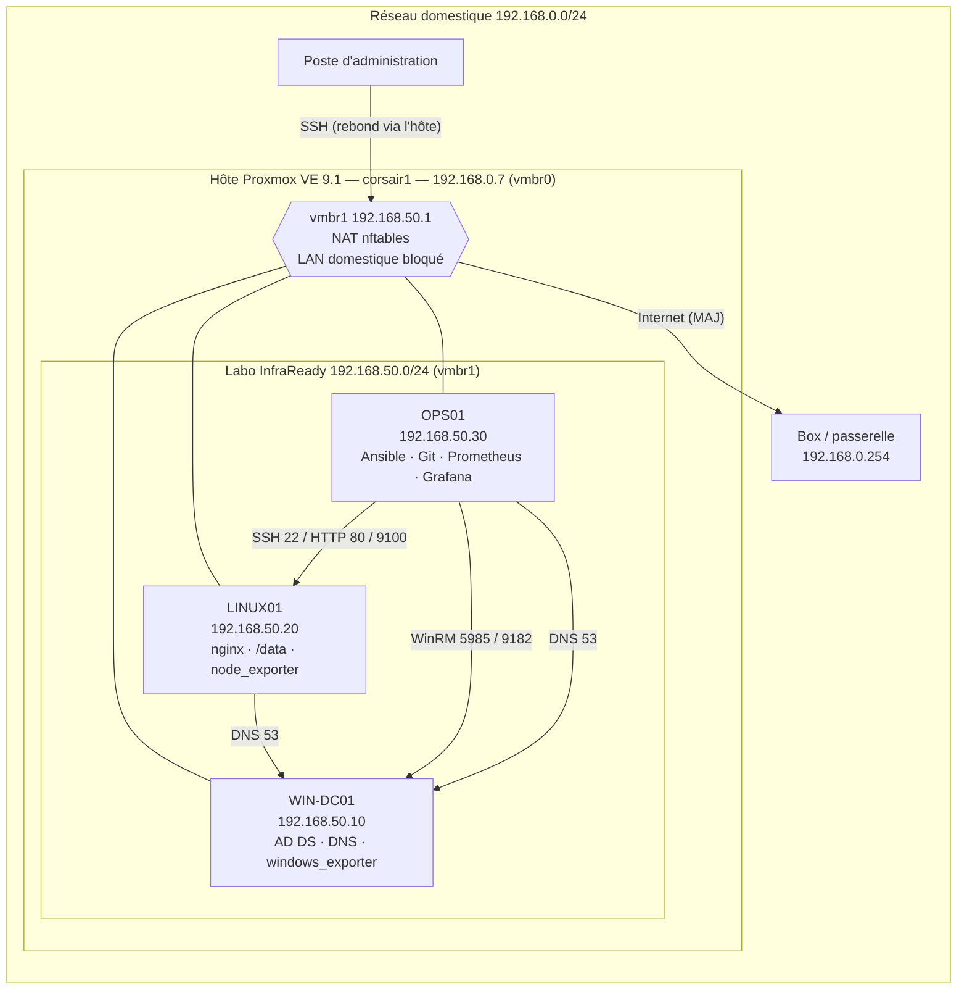
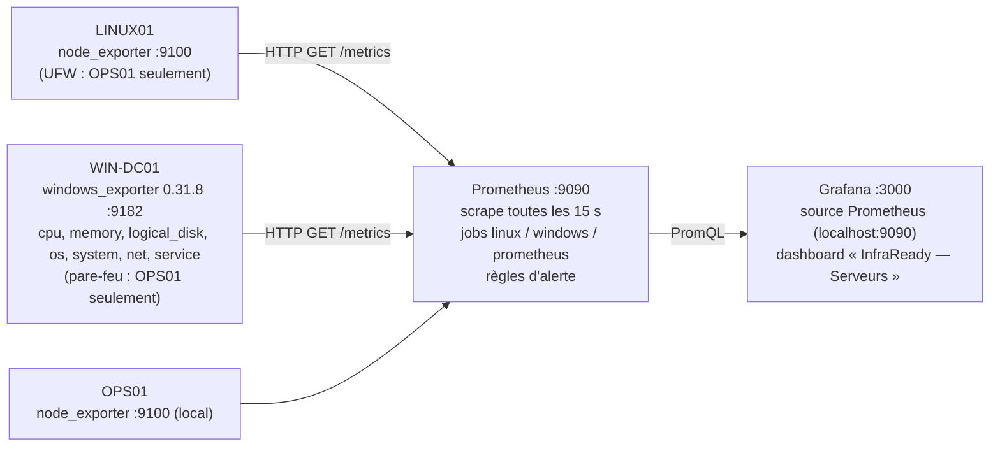
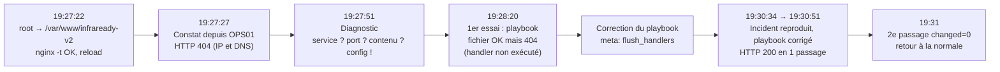

# InfraReady — Dossier technique

> [!info] À propos de ce dossier
> Rempli avec les configurations et preuves **réellement obtenues** sur le laboratoire. Chaque résultat renvoie à une preuve `P-xx` stockée dans `docs/preuves/` (sorties de commandes horodatées, captures). Aucun secret n'apparaît dans ce dossier ni dans le dépôt.

| Champ | Valeur |
| --- | --- |
| **Équipe** | MIR Mahan / Jolan Allen (chef de projet) / Kenzi Bendjelloul |
| **Classe** | B3 Cybersécurité |
| **Lien GitHub** | https://github.com/jolanallen/InfraReady |
| **Date / version** | 20/10/2026 — v0.4 |
| **Statut du projet** | Phases A à H et TP de la séance 4 réalisés — finalisation avant remise (bilans, PDF, oral) |

---

## 1. Présentation et périmètre

- **Contexte :** InfraReady souhaite standardiser ses configurations, automatiser l'administration et superviser ses serveurs Linux/Windows.
- **Besoin / contraintes :**
	- Laboratoire de 3 serveurs (1 Windows Server 2025, 2 Ubuntu Server 24.04 LTS), isolé du réseau personnel.
	- Administration reproductible (Ansible), supervision (Prometheus/Grafana), dépôt versionné et validé par CI.
	- Aucune donnée réelle : comptes, groupes et données sont fictifs.
- **Répartition de l'équipe :** Jolan Allen, chef de projet (planification, coordination, suivi et dépôt de remise) ; Kenzi Bendjelloul, partie Ansible (phase D) ; les autres phases ont été réalisées conjointement par MIR Mahan et Jolan Allen.
- **Conventions de preuves :** numérotation par phase — A = P-0x, B = P-1x, C = P-2x, D = P-3x, E = P-4x, F = P-5x, G = P-6x, H = P-7x. Les sorties sont capturées automatiquement avec l'heure et la commande exécutée.

---

## 2. Architecture et inventaire



| Machine | VMID | OS | Rôle | Ressources réelles | IP |
| --- | --- | --- | --- | --- | --- |
| WIN-DC01 | 100 | Windows Server 2025 Standard Evaluation (Desktop Experience) | AD DS / DNS | 4 vCPU (2×2) · 6 Go · 50 Go (IDE), UEFI + TPM 2.0, carte e1000e | 192.168.50.10 |
| LINUX01 | 101 | Ubuntu Server 24.04.5 LTS | Services Linux (nginx), stockage | 4 vCPU (2×2) · 4 Go · 30 Go + **10 Go de test** (`/data`) | 192.168.50.20 |
| OPS01 | 102 | Ubuntu Server 24.04.5 LTS | Ansible, Git, Prometheus, Grafana | 8 vCPU (2×4) · 6 Go · 50 Go | 192.168.50.30 |

| Paramètre | Valeur |
| --- | --- |
| **Hyperviseur / réseau** | Proxmox VE 9.1.1 (au lieu de VMware Workstation — voir écarts). Pont dédié `vmbr1` sans carte physique, NAT vers `vmbr0`. |
| **Sous-réseau validé** | 192.168.50.0/24 — passerelle 192.168.50.1 (hôte Proxmox) |
| **Domaine / DNS** | `infraready.test` (NetBIOS `INFRAREADY`) — DNS = 192.168.50.10, redirecteurs 1.1.1.1 / 9.9.9.9 |
| **Adaptations matérielles** | Hôte 16 cœurs / ~46 Go RAM : pas de réduction nécessaire. Disques sur pool ZFS `pool-ssd`. |

**Flux autorisés / pare-feu**

| Source | Destination | Port | Justification | Contrôle |
| --- | --- | --- | --- | --- |
| Labo 192.168.50.0/24 | Internet | tous (sortant) | Mises à jour, téléchargements | NAT nftables sur l'hôte |
| Labo 192.168.50.0/24 | Réseau domestique 192.168.0.0/24 | — | **Interdit** (isolation) | nftables `forward` : `ct state new drop` |
| Labo (dont rebond hôte .1) | LINUX01 | 22/tcp | Administration SSH | UFW (clé uniquement, mot de passe désactivé) |
| Labo | LINUX01 | 80/tcp | Service web | UFW |
| OPS01 (.30) | LINUX01 | 9100/tcp | node_exporter | UFW (OPS01 seul) |
| Labo | WIN-DC01 | 5985/tcp | WinRM (Ansible) | Pare-feu Windows limité à 192.168.50.0/24 |
| OPS01 (.30) | WIN-DC01 | 9182/tcp | windows_exporter | Pare-feu Windows (OPS01 seul) |
| Labo | WIN-DC01 | 53, 88, 389, 445… | DNS / Kerberos / LDAP / SMB | Règles AD par défaut de Windows |
| Labo | WIN-DC01 | ICMP echo | Tests de connectivité | Pare-feu Windows limité au labo |

---

## 3. Phase A — Installation et réseau

> [!abstract] Objectif
> Mettre en service les VM, les noms, les adresses et la connectivité du laboratoire.

**Responsable :** MIR Mahan / Jolan Allen · **Dates :** 19/10/2026 · **Statut :** Fait

### Travaux réalisés / checklist

- [x] Créer WIN-DC01, LINUX01 et OPS01 (Proxmox VE, VMID 100 à 102).
- [x] Installer Windows Server 2025 et Ubuntu Server 24.04 LTS (installations automatiques).
- [x] Configurer les noms d'hôtes et les adresses IP fixes.
- [x] Configurer le réseau virtuel et vérifier l'isolation.
- [x] Tester les communications IP entre VM.
- [x] Configurer et tester la résolution DNS du domaine.
- [x] Actualiser le schéma d'architecture selon le déploiement réel.

### Procédure et configuration

**Réseau du labo (hôte Proxmox)** — sauvegarde préalable de `/etc/network/interfaces` (`interfaces.bak-infraready`), puis ajout du pont `vmbr1` (fichier `lab/proxmox/vmbr1.interfaces`) et des règles `lab/proxmox/infraready-nat.nft` :
- `masquerade` des adresses 192.168.50.0/24 sortant par `vmbr0` (accès Internet) ;
- `drop` de toute **nouvelle** connexion du labo vers 192.168.0.0/24 (isolation du réseau domestique).

L'hôte n'ayant pas `iptables`, la NAT est écrite en **nftables** dans une table dédiée (`infraready_nat`), chargée/supprimée par `post-up`/`post-down` du pont.

**Installations automatiques** (aucune saisie manuelle) :

| VM | Méthode | Points clés |
| --- | --- | --- |
| LINUX01 / OPS01 | ISO `ubuntu-24.04.5-live-server-amd64.iso` (SHA-256 vérifié) + 2ᵉ lecteur « CIDATA » contenant un fichier **autoinstall** (`lab/autoinstall-user-data.yml.tpl`) | Hostname, IP fixe, LVM sur tout le disque, clavier fr, compte `infraadmin` (mot de passe haché SHA-512), SSH par clé uniquement, `qemu-guest-agent`, MAJ de sécurité pendant l'installation |
| WIN-DC01 | ISO Windows Server 2025 Eval + 2ᵉ lecteur contenant `autounattend.xml` (`lab/autounattend.xml.tpl`) | Image n°2 (Standard, Desktop Experience) identifiée dans `install.wim`, partitionnement UEFI/GPT, nom `WIN-DC01`, IP fixe par adresse MAC, fuseau Romance, clavier fr, WinRM + ping autorisés **depuis le labo uniquement** |

Les fichiers de réponse contenant de vrais mots de passe ont été **supprimés du stockage Proxmox** après installation ; le dépôt ne contient que des modèles avec `__PLACEHOLDERS__`.

**DNS** : après création du domaine (phase B), les VM Linux pointent sur le DC (`/etc/netplan/50-cloud-init.yaml` : `nameservers 192.168.50.10`, `search infraready.test`, sauvegarde dans `/root/`). La configuration réseau de cloud-init est désactivée par l'installeur (`90-installer-network.cfg`) : le changement est persistant.

**Commandes réellement utilisées** : `qm set / qm start / qm sendkey / qm snapshot`, `nft list table`, `ip -br addr`, `ip route`, `ping`, `curl`, `resolvectl dns|domain|query`, `getent ahostsv4`, `Get-NetIPConfiguration`, `Resolve-DnsName`, `Test-Connection`.

![[P-03-win-dc01-installe-server-manager.png|600]]

### Tests et preuves

| Vérification | Attendu | Résultat observé | Preuve |
| --- | --- | --- | --- |
| Démarrage des trois VM | Trois VM fonctionnelles | 3 VM `running`, snapshot `s01_installation_ok` sur chacune ; Windows installé en ~10 min, Ubuntu en ~6 min | [P-01](docs/preuves/P-01-proxmox-vms-et-reseau.txt), [P-03](docs/preuves/P-03-win-dc01-installe-server-manager.png) |
| Adressage IP | IP conforme au plan validé | .10 / .20 / .30, passerelle 192.168.50.1, toutes sur `vmbr1` | [P-02](docs/preuves/P-02-linux01-ip-connectivite-isolation.txt), [P-02b](docs/preuves/P-02b-ops01-ip-connectivite-isolation.txt), [P-04c](docs/preuves/P-04c-win-dc01-ip-dns.txt) |
| Connectivité croisée | Communication autorisée fonctionnelle | Ping OK entre les 3 VM et vers la passerelle ; Internet OK (HTTP 200 archive.ubuntu.com) | [P-02](docs/preuves/P-02-linux01-ip-connectivite-isolation.txt), [P-02b](docs/preuves/P-02b-ops01-ip-connectivite-isolation.txt), [P-04c](docs/preuves/P-04c-win-dc01-ip-dns.txt) |
| Isolation | Labo sans accès au réseau domestique | 192.168.0.254 **bloqué** depuis le labo, mais répond depuis l'hôte → blocage dû à la règle nftables | [P-02](docs/preuves/P-02-linux01-ip-connectivite-isolation.txt) |
| Résolution DNS | Enregistrements / domaine résolus | A, PTR et SRV `_ldap._tcp.dc._msdcs` résolus depuis les 2 VM Linux et le DC ; nom court `win-dc01` résolu grâce au domaine de recherche | [P-04](docs/preuves/P-04-linux01-resolution-dns-domaine.txt), [P-04b](docs/preuves/P-04b-ops01-resolution-dns-domaine.txt), [P-04c](docs/preuves/P-04c-win-dc01-ip-dns.txt) |

### Difficultés / décision / retour arrière

| Problème | Cause | Correction | Résultat |
| --- | --- | --- | --- |
| Les VM Linux avaient l'ISO Ubuntu **26.04** | Mauvaise ISO attachée à la création | Téléchargement d'Ubuntu 24.04.5 sur l'hôte, SHA-256 vérifié, ISO remplacée | Conforme au sujet |
| Carte réseau `e1000` sur WIN-DC01 | Pilote non garanti sur Windows Server 2025 | Passage en `e1000e` (même adresse MAC) | Réseau fonctionnel dès l'installation |
| L'installeur Ubuntu demande « Continue with autoinstall? » | Mot-clé `autoinstall` absent de la ligne de commande du noyau | Réponse `yes` envoyée par `qm sendkey` | Installation sans autre intervention |
| Pas d'`iptables` sur l'hôte Proxmox 9 | Système basé sur nftables | Règles écrites en nftables, table dédiée | NAT + isolation fonctionnelles |
| Le DC n'avait pas d'enregistrement PTR | Zone inverse créée **après** la promotion du DC | `windows_base.yml` déclenche l'enregistrement dynamique du DC (`Register-DnsClient`) si son PTR manque (voir phase D) | PTR .10 résolu ([P-35](docs/preuves/P-35-playbook-windows-correction-ptr-dc.txt), [P-37](docs/preuves/P-37-playbook-windows-ptr-dc-stable.txt)) |
| Mot de passe `sudo` de l'hôte visible dans l'en-tête d'une preuve | Le script de capture recopiait la commande complète | Preuve nettoyée, script corrigé (affiche `sudo`), vérification systématique avant chaque commit | Aucun secret dans le dépôt |

Retour arrière disponible : snapshot `s01_installation_ok` (3 VM) et `interfaces.bak-infraready` sur l'hôte.

---

## 4. Phase B — Administration Windows

> [!abstract] Objectif
> Rendre l'annuaire et le DNS opérationnels, documenter comptes, groupes et journaux.

**Responsable :** MIR Mahan / Jolan Allen · **Dates :** 19/10/2026 · **Statut :** Fait

### Travaux réalisés / checklist

- [x] Installer AD DS sur WIN-DC01.
- [x] Créer le domaine de laboratoire et configurer DNS.
- [x] Créer au moins deux groupes de test.
- [x] Créer plusieurs comptes de test et les affecter aux groupes.
- [x] Décrire les droits et accès attribués.
- [x] Vérifier les journaux et événements Windows pertinents.
- [x] Démontrer l'état du domaine et les tests DNS.

### Procédure et configuration

Snapshot `s02_avant_adds` pris avant toute modification. Les actions sont lancées depuis OPS01 via WinRM (Ansible) :

1. **AD DS + forêt** — playbook `ansible/playbooks/windows_adds.yml` (équivalent PowerShell indiqué en tête du fichier : `Install-WindowsFeature AD-Domain-Services`, `Install-ADDSForest`) :
	- forêt `infraready.test`, NetBIOS `INFRAREADY`, niveau fonctionnel **Windows2025Domain / Windows2025Forest** ;
	- DNS intégré à AD, redirecteurs 1.1.1.1 et 9.9.9.9, le DC utilise son propre DNS ;
	- source de temps NTP `fr.pool.ntp.org` (le DC racine fournit l'heure au domaine — indispensable pour Kerberos) ;
	- mot de passe DSRM fourni depuis le **vault Ansible chiffré**.
2. **Objets de l'annuaire** — script `scripts/ad-objets.ps1` (rejouable, mot de passe initial passé en paramètre depuis le vault) :

| OU | Groupe (global, sécurité) | Membres | Rôle fictif |
| --- | --- | --- | --- |
| `OU=Groupes,OU=InfraReady` | `GG_Support_IT` | j.martin, s.bernard | Support informatique |
| `OU=Groupes,OU=InfraReady` | `GG_Comptabilite` | l.petit, t.moreau | Service comptabilité |

Comptes dans `OU=Utilisateurs,OU=InfraReady`, activés, **changement de mot de passe obligatoire à la première connexion**. OU protégées contre la suppression accidentelle.

**Droits et accès attribués** (appliqués par `windows_base.yml`, phase D) :

| Ressource | GG_Comptabilite | GG_Support_IT | Autres utilisateurs |
| --- | --- | --- | --- |
| Partage SMB `\\WIN-DC01\Compta` | Modification (Change) | Lecture | Aucun accès (partage masqué de l'énumération) |
| NTFS `C:\Partages\Comptabilite` | Modify | ReadAndExecute | `BUILTIN\Users` retiré, héritage désactivé |

Principe : moindre privilège — le support peut consulter pour dépanner, seule la comptabilité modifie.

**Outils réellement utilisés** : `Get-ADDomain`, `Get-ADForest`, `Get-ADUser`, `Get-ADGroupMember`, `Resolve-DnsName`, `Get-DnsServerZone`, `Get-DnsServerForwarder`, `dcdiag`, `w32tm`, `Get-WinEvent`, Server Manager (capture P-03).

### Tests et preuves

| Vérification | Attendu | Résultat observé | Preuve |
| --- | --- | --- | --- |
| Domaine AD | Domaine créé et accessible | `infraready.test` / `INFRAREADY`, DC `WIN-DC01.infraready.test`, catalogue global ; dcdiag : 10 tests fonctionnels réussis (Connectivity, Advertising, SysVolCheck, MachineAccount, NetLogons, RidManager, Services, DNS ×2, FsmoCheck) | [P-10](docs/preuves/P-10-adds-installation-foret.txt), [P-12](docs/preuves/P-12-domaine-dns-verifications.txt), [P-12b](docs/preuves/P-12b-dcdiag-tests-fonctionnels-ntp.txt) |
| Comptes et groupes | Au moins 2 groupes + plusieurs comptes présents | 2 groupes, 4 comptes, appartenances conformes | [P-11](docs/preuves/P-11-ad-ou-groupes-comptes.txt), [P-12](docs/preuves/P-12-domaine-dns-verifications.txt) |
| DNS interne | Résolution du domaine validée | A `infraready.test` et `win-dc01` → .10, SRV LDAP, résolution externe via redirecteurs, zones intégrées AD en mise à jour sécurisée | [P-12](docs/preuves/P-12-domaine-dns-verifications.txt), [P-04c](docs/preuves/P-04c-win-dc01-ip-dns.txt) |
| Journaux Windows | Événements vérifiés et interprétés | voir interprétation ci-dessous | [P-13](docs/preuves/P-13-journaux-windows-ad.txt) |

**Interprétation des journaux (P-13)**

| Journal / ID | Observation | Interprétation |
| --- | --- | --- |
| System 1074 — 15:10:51 | Redémarrage demandé par `shutdown.exe` | Redémarrage de fin de promotion du DC |
| Directory Service 1000 — 15:12:07 | « AD DS startup complete » | Annuaire démarré après promotion |
| DNS Server 2 et 4 — 15:12:38 | Serveur DNS démarré, zones chargées | DNS intégré AD opérationnel |
| Security 4727 / 4720 / 4728 — 15:11:58 | Groupes, comptes et appartenances créés | Comptes et groupes **intégrés** créés avec la forêt |
| Security 4727 / 4720 / 4728 — 15:14:34-35 | 2 groupes, 4 comptes, 4 ajouts aux groupes | Exécution de `ad-objets.ps1` (traçabilité de nos actions) |
| dcdiag `DFSREvent`, `SystemLog` en échec | Erreurs RID pool, SYSVOL non partagé, à 15:12:37 | Événements **transitoires du premier démarrage** d'une nouvelle forêt ; les tests fonctionnels associés (RidManager, SysVolCheck) passent ensuite |

### Difficultés / décision / retour arrière

| Problème | Cause | Correction | Résultat |
| --- | --- | --- | --- |
| 1er lancement de `windows_adds.yml` en échec | Paramètre `reboot_timeout` inexistant dans `microsoft.ad` 1.4.1 (version fournie par Ubuntu) | Paramètre retiré (délai par défaut suffisant) | Forêt créée au 2ᵉ lancement ([P-10a](docs/preuves/P-10a-adds-premier-essai-echec-reboot_timeout.txt) → [P-10](docs/preuves/P-10-adds-installation-foret.txt)) |
| DC synchronisé sur sa propre horloge (« Local CMOS Clock ») | Configuration par défaut | NTP externe configuré dans le playbook | Stratum 2, synchronisé ([P-12b](docs/preuves/P-12b-dcdiag-tests-fonctionnels-ntp.txt)) |
| Événements horodatés **23:52** (dans le futur) | **Hypothèse** : saut d'horloge pendant la promotion, avant toute synchronisation NTP | NTP configuré ; heure du DC vérifiée identique à OPS01 | Plus de dérive observée |
| `win_powershell` refuse le paramètre `path` | Option absente d'`ansible.windows` 2.2.0 | Contenu du script passé par `lookup('file', …)` | Scripts exécutés à distance |

Retour arrière disponible : snapshots `s02_avant_adds` et `s03_avant_ansible` de WIN-DC01.

---

## 5. Phase C — Administration Linux

> [!abstract] Objectif
> Gérer identités, permissions, services, stockage, mises à jour et journaux sur Ubuntu.

**Responsable :** MIR Mahan / Jolan Allen · **Dates :** 19/10/2026 · **Statut :** Fait

### Travaux réalisés / checklist

- [x] Créer et configurer des utilisateurs et groupes Linux.
- [x] Attribuer et vérifier les permissions.
- [x] Installer un service applicatif simple (nginx).
- [x] Administrer et contrôler les processus et services.
- [x] Ajouter un disque virtuel de test, créer un système de fichiers.
- [x] Configurer et documenter le montage du disque.
- [x] Mettre Ubuntu à jour selon une procédure contrôlée.
- [x] Lire et analyser des journaux système.

### Procédure et configuration

Réalisée **manuellement** sur LINUX01 (commandes conservées dans l'en-tête de chaque preuve), puis reprise dans Ansible en phase D.

**Identités et permissions**

| Compte | Groupes | Usage |
| --- | --- | --- |
| alice, bruno | `webadmins` | Mettent à jour le site web |
| chloe | `auditeurs`, `systemd-journal` | Consulte les journaux et rapports, sans droit d'écriture |
| ansible | — (sudo sans mot de passe, clé SSH) | Compte de service pour l'automatisation |

Les comptes du labo sont **verrouillés** (`passwd -S` → `L`) : aucun mot de passe utilisable, accès via `sudo -u` uniquement.

| Dossier | Propriétaire | Mode | Effet |
| --- | --- | --- | --- |
| `/var/www/infraready` | root:webadmins | `2775` (setgid) | webadmins écrivent, les fichiers héritent du groupe ; les autres lisent |
| `/data/rapports` | root:auditeurs | `2750` | auditeurs lisent, aucun accès pour les autres |

**Service** : nginx 1.24, site `infraready` (vhost dédié, journaux séparés `infraready_access.log` / `infraready_error.log`), site par défaut désactivé, `nginx -t` avant chaque rechargement.

**Stockage** : disque de 10 Go ajouté **à chaud** (`qm set 101 --scsi1 pool-ssd:10,serial=INFRA-DATA01`), identifié par son **numéro de série** (`/dev/disk/by-id/scsi-SQEMU_QEMU_HARDDISK_INFRA-DATA01` → `/dev/sdb`). Formatage uniquement si les 5 contrôles sont conformes (taille 10G, aucune signature, aucune partition, non monté, différent du disque système), sinon arrêt automatique. Système de fichiers ext4 (label `DATA`), montage `/data` **par UUID** avec `nofail` dans `/etc/fstab`.

**Mise à jour contrôlée** : (1) snapshot `s02_avant_maj_c` ; (2) pré-contrôles disque et services ; (3) `apt-get update` + simulation `apt-get -s upgrade` ; (4) `apt-get upgrade` (jamais de suppression de paquet), conservation des fichiers de configuration locaux ; (5) contrôle de `/var/log/apt/history.log` ; (6) vérification de `/var/run/reboot-required`.

**Commandes réellement utilisées** : `groupadd`, `useradd`, `id`, `getent`, `passwd -S`, `chmod`, `chown`, `ls -l`, `sudo -u`, `nginx -t`, `systemctl status|stop|start|restart|is-enabled`, `ss -tlnp`, `ps`, `pgrep`, `curl`, `lsblk`, `wipefs -n`, `mkfs.ext4`, `blkid`, `findmnt`, `mount -a`, `df -hT`, `apt-get`, `journalctl`, `uptime`, `free`.

### Tests et preuves

| Vérification | Attendu | Résultat observé | Preuve |
| --- | --- | --- | --- |
| Comptes / permissions | Droits conformes au besoin | alice écrit dans le site ✔, chloe refusée ✔ ; chloe lit le journal ✔, alice non ✔ ; chloe lit `/data/rapports` ✔, alice refusée ✔ | [P-20](docs/preuves/P-20-linux01-comptes-groupes-permissions.txt), [P-22](docs/preuves/P-22-linux01-disque-test-montage.txt) |
| Service applicatif | Service accessible et fonctionnel | `nginx -t` OK, actif et activé au démarrage, port 80 en écoute, HTTP 200 depuis OPS01 ; stop → HTTP 000, start → 200, restart → nouveau PID maître | [P-21](docs/preuves/P-21-linux01-service-nginx-processus.txt) |
| Stockage de test | Disque formaté sur la bonne cible et monté | Contrôles conformes, `/dev/sdb` ext4 9.8G monté sur `/data` par UUID, remontage via fstab réussi | [P-22](docs/preuves/P-22-linux01-disque-test-montage.txt) |
| Maintenance et logs | Mises à jour et journaux vérifiés | 20 paquets mis à jour (code retour 0), pas de redémarrage requis ; tentative SSH « pirate » et requête 404 retrouvées dans les journaux ; aucune erreur ni unité en échec | [P-23](docs/preuves/P-23-linux01-mise-a-jour-controlee.txt), [P-24](docs/preuves/P-24-linux01-analyse-journaux.txt) |

**Analyse des journaux (P-24)** : `sshd` enregistre `Invalid user pirate from 192.168.50.30` (connexion refusée avant authentification) ; nginx trace `GET /admin.php … 404` depuis OPS01 ; le noyau trace l'arrivée à chaud de `sdb` (10.7 GB) ; `journalctl -p err -b` vide ; `sudo` trace chaque commande privilégiée avec l'utilisateur à l'origine.

### Difficultés / décision / retour arrière

| Problème | Cause | Correction | Résultat |
| --- | --- | --- | --- |
| Premiers contrôles « avant formatage » exécutés sur un chemin inexistant | Nom `/dev/disk/by-id/…` deviné au lieu d'être lu | Aucun formatage n'avait lieu dans ce premier script ; lecture du vrai nom (`ls -l /dev/disk/by-id`) et ajout d'un **arrêt automatique** si un contrôle n'est pas conforme | Formatage sur la bonne cible uniquement |

Retour arrière disponible : snapshot `s02_avant_maj_c` (inclut le disque de test), sauvegarde netplan dans `/root/`.

---

## 6. Phase D — Automatisation avec Ansible

> [!abstract] Objectif
> Fournir des playbooks Linux et Windows reproductibles et idéalement idempotents.

**Responsable :** Kenzi Bendjelloul · **Dates :** 19/10/2026 · **Statut :** Fait

### Travaux réalisés / checklist

- [x] Installer et préparer Ansible sur OPS01.
- [x] Créer l'inventaire et les variables nécessaires.
- [x] Configurer/tester SSH pour Linux et WinRM pour Windows.
- [x] Créer au moins un playbook Linux.
- [x] Créer au moins un playbook Windows.
- [x] Automatiser plusieurs tâches de configuration.
- [x] Contrôler la bonne exécution et traiter les erreurs.
- [x] Rejouer les playbooks et évaluer l'idempotence.
- [x] Documenter commandes, prérequis, dépendances et résultats.

### Procédure et configuration

**Prérequis sur OPS01** : `apt install ansible python3-winrm git jq` → ansible-core 2.16.3 avec les collections `ansible.windows` 2.2.0, `ansible.posix` 1.5.4, `community.general` 8.3.0, `community.windows` 2.1.0, `microsoft.ad` 1.4.1 (liste dans `ansible/requirements.yml`).

**Compte de service** : `scripts/bootstrap-ansible-user.sh` crée l'utilisateur `ansible` (clé ed25519 générée sur OPS01, copiée sur LINUX01, sudo sans mot de passe validé par `visudo -c`).

**Fichiers**

| Fichier | Contenu |
| --- | --- |
| `ansible/ansible.cfg` | Inventaire, journal `~/infraready-logs/ansible.log`, minutage des tâches, fichier de mot de passe du vault (hors dépôt) |
| `inventory/hosts.yml` | Groupes `linux` (linux01, ops01 en connexion locale), `windows` (win-dc01), `monitoring` |
| `group_vars/all.yml` | Sous-réseau, domaine, IP du DC et d'OPS01, fuseau horaire |
| `group_vars/linux/vars.yml` | SSH avec l'utilisateur `ansible` + clé, `become` |
| `group_vars/windows/vars.yml` | WinRM HTTP 5985, NTLM (message chiffré), mot de passe lu dans le vault |
| `group_vars/windows/vault.yml` | **Chiffré AES256** (Ansible Vault) : mots de passe Administrateur, DSRM, initial des comptes AD |

**Playbooks**

| Playbook | Cible | Actions automatisées | Vérifications intégrées |
| --- | --- | --- | --- |
| `windows_adds.yml` | WIN-DC01 | Rôle AD DS, forêt, NTP, redirecteurs et client DNS | Attente des services AD, état du domaine |
| `linux_base.yml` | LINUX01 | Fuseau, paquets, groupes/comptes, droits du site, template nginx + handler de rechargement, montage `/data` par UUID, droits `/data/rapports`, **pare-feu UFW** (22 et 80 depuis le labo, 9100 depuis OPS01, refus par défaut), node_exporter | HTTP 200 sur le site, `/metrics` de node_exporter |
| `windows_base.yml` | WIN-DC01 | OU, groupes, comptes (`no_log`), dossier + ACL NTFS + partage SMB, zone inverse, enregistrements A/PTR, windows_exporter **0.31.8** (MSI), règle de pare-feu 9182 réservée à OPS01 | Services NTDS, DNS, Netlogon, kdc, windows_exporter démarrés (`assert`), `/metrics` joignable depuis OPS01 |

**Commandes réellement utilisées** : `ansible --version`, `ansible-inventory --graph`, `ansible linux -m ping`, `ansible windows -m win_ping`, `ansible-playbook playbooks/<nom>.yml [--diff]`, lancées deux fois de suite.

### Tests et preuves

| Vérification | Attendu | Résultat observé | Preuve |
| --- | --- | --- | --- |
| Inventaire Ansible | Hôtes Linux et Windows décrits | 3 hôtes dans 3 groupes | [P-30](docs/preuves/P-30-ansible-inventaire-connexions.txt) |
| Connexions | Linux SSH et Windows transport validés | `ping: pong` (linux01, ops01) et `win_ping: pong` (win-dc01) | [P-30](docs/preuves/P-30-ansible-inventaire-connexions.txt) |
| Playbook Linux | Exécution sans erreur bloquante | ok=22 changed=10 failed=0 | [P-31](docs/preuves/P-31-playbook-linux-1er-passage.txt) |
| Playbook Windows | Exécution sans erreur bloquante | ok=21 changed=12 failed=0 | [P-33](docs/preuves/P-33-playbook-windows-1er-passage.txt) |
| Second passage | État stable / changements expliqués | **Linux changed=0**, **Windows changed=0** | [P-32](docs/preuves/P-32-playbook-linux-2e-passage-idempotence.txt), [P-34](docs/preuves/P-34-playbook-windows-2e-passage-idempotence.txt) |

**Changements du 1er passage Linux expliqués** : paquets absents (node_exporter, ufw, acl, htop), description du compte chloe différente de la saisie manuelle, page et vhost remplacés par les templates, ligne fstab réécrite au format Ansible, 4 règles UFW nouvelles, rechargement nginx (handler). **Windows** : partage, ACL, DNS et exporter n'existaient pas ; OU, groupes et comptes déjà créés en phase B → `ok` sans changement.

### Difficultés / décision / retour arrière

| Problème | Cause | Correction | Résultat |
| --- | --- | --- | --- |
| windows_exporter 0.31.9 disponible | Version publiée 9 jours plus tôt | Choix de **0.31.8** (stable depuis 3 mois) | Version figée, surchargeable par variable d'environnement |
| L'option MSI `ADDLOCAL=FirewallException` ouvre 9182 à tout le monde | Comportement de l'installeur | Option retirée, règle dédiée limitée à OPS01 | Port 9182 exposé à OPS01 seulement |
| PTR du DC absent (vu en phase A) | Zone inverse créée après la promotion | 1ʳᵉ correction : PTR du DC ajouté à la liste gérée par le playbook (changed=1 puis 0) | [P-35](docs/preuves/P-35-playbook-windows-correction-ptr-dc.txt) |
| Playbook de nouveau `changed=1` plus tard, sur ce même PTR | **Cause confirmée** : le DC enregistre lui-même son PTR par mise à jour dynamique (TTL 20 min, horodaté) ; le playbook le réécrivait en statique (TTL 1 h) → chacun écrasait l'autre à tour de rôle | Le playbook ne gère plus le PTR du DC : il ne déclenche `Register-DnsClient` que si le PTR manque. Seuls les hôtes Linux (qui ne s'enregistrent pas) restent gérés en statique | `changed=0` sur 2 passages, y compris juste après un réenregistrement forcé du DC ([P-36b](docs/preuves/P-36b-ptr-dc-apres-reenregistrement-dynamique.txt), [P-37](docs/preuves/P-37-playbook-windows-ptr-dc-stable.txt)) |
| 1ʳᵉ exécution du workflow GitHub Actions en échec | Dashboard Grafana pas encore écrit, une ligne > 160 caractères, 7 remarques `ansible-lint` (chemins relatifs, noms de tâches) | Dashboard créé, playbooks corrigés, mêmes outils installés localement (ansible-core 2.16 + collections aux versions d'OPS01) pour valider avant de pousser | yamllint, syntax-check et ansible-lint (profil `production`) OK en local ; playbooks rejoués : `changed=0` |

Retour arrière disponible : snapshot `s03_avant_ansible` (WIN-DC01 et LINUX01).

---

## 7. Phase E — Maintenance et mises à jour

> [!abstract] Objectif
> Formaliser et tester une maintenance sûre et traçable sur les deux OS.

**Responsable :** MIR Mahan / Jolan Allen · **Dates :** 19/10/2026 · **Statut :** Fait

### Travaux réalisés / checklist

- [x] Écrire une procédure de maintenance standard (`docs/procedure-maintenance.md`).
- [x] Automatiser les mises à jour Linux (`linux_maintenance.yml` + `unattended-upgrades` quotidien).
- [x] Documenter et tester les mises à jour Windows (`windows_maintenance.yml` : recherche, installation, redémarrage, post-contrôles).
- [x] Vérifier l'espace disque et l'état des services (pré- et post-contrôles automatiques).
- [x] Documenter les précautions avant redémarrage et changement majeur.
- [x] Conserver une trace des exécutions et résultats (`ansible.log` + un rapport par serveur).

### Procédure et configuration

La procédure complète est dans **`docs/procedure-maintenance.md`** (fenêtre, ordre LINUX01 → OPS01 → WIN-DC01 en dernier, précautions, retour arrière). Elle est outillée par deux playbooks qui **refusent de continuer** si un pré-contrôle échoue :

| Étape | Linux (`linux_maintenance.yml`, un serveur à la fois) | Windows (`windows_maintenance.yml`) |
| --- | --- | --- |
| 0. Retour arrière | Snapshot Proxmox `s04_avant_maintenance_e` (LINUX01, OPS01) | Snapshot `s04_avant_maj_windows` (WIN-DC01) |
| 1. Pré-contrôles | Chaque système de fichiers < 85 % ; services attendus actifs (`ssh`, `nginx`, exporters, `prometheus`, `grafana-server`) | Volumes fixes < 85 % ; services NTDS, DNS, Netlogon, kdc, windows_exporter démarrés ; **aucun redémarrage déjà en attente** (clés CBS / Windows Update) |
| 2. Mises à jour | `unattended-upgrades` installé et configuré (sécurité quotidienne, pas de redémarrage auto) ; `apt upgrade` (jamais de suppression) ; `autoremove` | Recherche Windows Update (sécurité, critiques, cumulatives, définitions) ; installation **uniquement** avec `-e maintenance_apply=true` |
| 3. Redémarrage | Seulement si `/var/run/reboot-required` existe **et** `-e allow_reboot=true` | Seulement avec `-e allow_reboot=true` (géré par `win_updates`, 30 min max) |
| 4. Post-contrôles | Services de nouveau actifs ; site web HTTP 200 (LINUX01) | Services critiques démarrés ; `Get-ADDomain` + résolution DNS ; historique Windows Update |
| 5. Trace | `~/infraready-logs/maintenance-<hôte>-<date>.txt` sur OPS01 + `ansible.log` | idem + `C:\Windows\Temp\infraready-windowsupdate.log` |

**Commandes et interfaces réellement utilisées** : `ansible-playbook playbooks/linux_maintenance.yml`, `ansible-playbook playbooks/windows_maintenance.yml [-e maintenance_apply=true -e allow_reboot=true]`, `qm snapshot`, modules `apt`, `win_updates`, `service_facts`, `win_service_info`, faits `ansible_mounts`, `Get-Volume`, `Get-Service`, `Get-ADDomain`, `Resolve-DnsName`, `unattended-upgrade --dry-run`, `systemctl list-timers`.

### Tests et preuves

| Vérification | Attendu | Résultat observé | Preuve |
| --- | --- | --- | --- |
| Mise à jour Linux | Procédure automatisée vérifiable | LINUX01 : déjà à jour (phase C) ; OPS01 : paquets mis à jour ; aucun redémarrage requis ; `unattended-upgrades` actif (minuteries `apt-daily` 23:27 et `apt-daily-upgrade` 06:39), dry-run OK | [P-40](docs/preuves/P-40-linux-maintenance-standard.txt), [P-43](docs/preuves/P-43-linux01-mises-a-jour-automatiques-unattended.txt) |
| Mise à jour Windows | Procédure exécutée et documentée | Recherche : **5 mises à jour** ; installation en 1 h 13 avec redémarrage du DC (18:04) : cumulative `KB5126646` (build 26100.33650), .NET `KB5127690`, MSRT, plateforme et signatures Defender ; la tâche échoue sur `KB5007651` (boucle Windows Update, voir Difficultés) ; après exclusion, passage complet `failed=0`, dernière signature Defender installée sans redémarrage, services/AD/DNS OK | [P-41](docs/preuves/P-41-windows-maintenance-recherche-maj.txt), [P-42](docs/preuves/P-42-windows-maintenance-installation-maj.txt), [P-42b](docs/preuves/P-42b-win-dc01-diagnostic-kb5007651-historique-wu.txt), [P-42c](docs/preuves/P-42c-windows-maintenance-installation-complete-apres-exclusion.txt) |
| Capacité disque | État relevé et interprété | LINUX01 `/` 29,1 %, `/boot` 11,4 %, `/data` 5,3 % ; OPS01 `/` 26,1 % ; WIN-DC01 `C:` 24,2 % avant (37,1 Go libres) puis **37,2 %** après la cumulative (30,7 Go libres : WinSxS + fichiers de désinstallation) → tous < 85 %, marge suffisante | [P-40b](docs/preuves/P-40b-rapports-maintenance-generes.txt), [P-42c](docs/preuves/P-42c-windows-maintenance-installation-complete-apres-exclusion.txt) |
| État des services | Services critiques contrôlés | Avant et après : ssh/nginx/node_exporter (LINUX01), ssh/prometheus/grafana/node_exporter (OPS01), NTDS/DNS/Netlogon/kdc/windows_exporter (WIN-DC01) tous actifs ; site HTTP 200 | [P-40](docs/preuves/P-40-linux-maintenance-standard.txt), [P-40b](docs/preuves/P-40b-rapports-maintenance-generes.txt) |

### Difficultés / décision / retour arrière

| Problème | Cause | Correction | Résultat |
| --- | --- | --- | --- |
| 1er passage Windows : « un volume dépasse 85 % » alors que `C:` est à 24 % | Le lecteur CD vide (ISO éjectée) apparaît comme un volume `E:` de 0 octet → 100 % | Filtre sur les disques fixes de taille > 0 (`DriveType -eq 'Fixed'`) | Pré-contrôle correct ([P-41a](docs/preuves/P-41a-windows-maintenance-1er-essai-lecteur-cd.txt) → [P-41](docs/preuves/P-41-windows-maintenance-recherche-maj.txt)) |
| Ordre des phases | La maintenance d'OPS01 contrôle `prometheus` et `grafana-server` | Phase F exécutée avant la maintenance d'OPS01 | Pré-contrôles cohérents |
| Installation Windows : `failed=1` après 1 h 13 alors que 5 mises à jour sont installées et que le DC a redémarré | `KB5007651` (plateforme Windows Security) est marquée « Installation Successful » trois fois de suite (17:47, 18:06, 18:07) mais toujours re-proposée par Windows Update ; `win_updates` détecte la boucle et arrête la tâche, donc les post-contrôles n'ont pas tourné | Diagnostic avec `QueryHistory`, le journal Système (`WindowsUpdateClient`) et `Get-MpComputerStatus` (plateforme bien en 4.18.26090.9) ; ajout de `reject_list: [KB5007651]` dans le playbook, à suivre manuellement | Passage complet `failed=0`, post-contrôles OK ([P-42](docs/preuves/P-42-windows-maintenance-installation-maj.txt) → [P-42b](docs/preuves/P-42b-win-dc01-diagnostic-kb5007651-historique-wu.txt) → [P-42c](docs/preuves/P-42c-windows-maintenance-installation-complete-apres-exclusion.txt)) |
| Rapport Windows : l'historique Windows Update est écrit sur une seule ligne avec des `\n` littéraux | `join('\n')` dans un gabarit Jinja ne produit pas de retour à la ligne | Boucle `` dans le gabarit du rapport | Rapport lisible au passage suivant |

Retour arrière disponible : snapshots `s04_avant_maintenance_e` (LINUX01, OPS01) et `s04_avant_maj_windows` (WIN-DC01).

---

## 8. Phase F — Supervision Prometheus et Grafana

> [!abstract] Objectif
> Collecter et visualiser les métriques réelles des serveurs et présenter une alerte.

**Responsable :** MIR Mahan / Jolan Allen · **Dates :** 19/10/2026 · **Statut :** Fait

### Travaux réalisés / checklist

- [x] Installer et configurer Prometheus sur OPS01 (playbook `ops01_monitoring.yml`).
- [x] Configurer Node Exporter pour LINUX01 (installé par `linux_base.yml`, port 9100 ouvert pour OPS01).
- [x] Configurer Windows Exporter pour WIN-DC01 (0.31.8, port 9182 ouvert pour OPS01).
- [x] Vérifier les cibles et données reçues par Prometheus.
- [x] Installer/configurer Grafana avec Prometheus comme source.
- [x] Créer un dashboard avec CPU, mémoire, stockage, disponibilité.
- [x] Démontrer un seuil ou une alerte simple.
- [x] Documenter origine, ports et cheminement des métriques.

### Procédure et configuration

Tout est déployé par **`ansible/playbooks/ops01_monitoring.yml`** à partir des fichiers versionnés dans `monitoring/` (snapshot `s02_avant_monitoring` pris avant) :

| Composant | Version | Configuration | Vérification intégrée au playbook |
| --- | --- | --- | --- |
| Prometheus | 2.45.3 (paquet Ubuntu 24.04) | `/etc/prometheus/prometheus.yml` et `rules/infraready.rules.yml` copiés depuis le dépôt ; `promtool check config` **avant** tout redémarrage | `/api/v1/targets` : toutes les cibles `up` (sinon échec) |
| Grafana | 13.2.4 (dépôt officiel `apt.grafana.com`) | Source de données et dashboard **provisionnés** (`/etc/grafana/provisioning/`, JSON dans `/var/lib/grafana/dashboards/infraready/`) ; mot de passe admin dans le vault ; accès anonyme **Viewer** (lecture seule) pour l'affichage | Compte admin testé sur `/api/admin/stats` ; source `prometheus-infraready` présente |
| Pare-feu OPS01 | UFW | 22, 3000, 9090 depuis le labo uniquement, refus par défaut | — |

**Origine, ports et cheminement des métriques**



Chaque cible porte un label `host` (linux01, ops01, win-dc01) et `os`, utilisés dans les requêtes et la légende du dashboard.

**Dashboard « InfraReady — Serveurs »** (`monitoring/grafana/dashboards/infraready.json`, uid `infraready-serveurs`) — 5 panneaux : disponibilité (`up`), CPU %, mémoire %, stockage % par volume, table des alertes Prometheus actives. Requêtes Linux (`node_*`) et Windows (`windows_*`) côte à côte dans chaque panneau.

**Règles d'alerte** (`monitoring/prometheus/rules/infraready.rules.yml`, validées par `promtool` dans la CI) :

| Alerte | Condition | Durée | Sévérité |
| --- | --- | --- | --- |
| `InstanceDown` | `up == 0` (cible Linux ou Windows) | 1 min | critical |
| `ServiceWindowsCritiqueArrete` | service DNS / NTDS / Netlogon / Kdc non `running` (collecteur `service`) | 1 min | critical |
| `CpuEleve` | CPU > 80 % | 2 min | warning |
| `MemoireElevee` | mémoire > 90 % | 5 min | warning |
| `DisquePresquePlein` | volume > 85 % | 5 min | warning |

**Démonstration d'alerte** (contrôlée et réversible, rejouée 3 fois avec le même résultat) : arrêt de `prometheus-node-exporter` sur LINUX01 → `InstanceDown[linux01]` passe en `pending` après 10 s, puis **`firing` après 60 s** (durée `for: 1m`) ; dashboard : LINUX01 « HORS LIGNE » et alerte dans la table ; redémarrage du service → alerte disparue 16 s plus tard.

**Points de contrôle réellement utilisés** : `/api/v1/targets`, `/api/v1/rules`, `/api/v1/alerts`, `/api/v1/query`, page `/classic/targets` et `/classic/alerts`, `/metrics` de chaque exporter, API Grafana (`/api/health`, `/api/admin/stats`, `/api/datasources`), `ss -tlnp`, `promtool check config`.

![[P-53-grafana-dashboard-infraready.png|700]]

![[P-55-grafana-dashboard-alerte-linux01-hors-ligne.png|700]]

### Tests et preuves

| Vérification | Attendu | Résultat observé | Preuve |
| --- | --- | --- | --- |
| Collecte Linux | Métriques de LINUX01 disponibles | Cible `192.168.50.20:9100` **up** (scrape 60 ms, 1 709 métriques) ; CPU 0,2 %, mémoire 11,3 %, `/` 29,1 %, `/data` 5,3 % | [P-51](docs/preuves/P-51-prometheus-targets.png), [P-52](docs/preuves/P-52-prometheus-cibles-metriques-regles.txt) |
| Collecte Windows | Métriques de WIN-DC01 disponibles | Cible `192.168.50.10:9182` **up** (3 263 métriques) ; CPU 1,0 %, mémoire 26,7 %, `C:` 24,2 % ; services DNS/NTDS/Netlogon/Kdc `running=1` | [P-51](docs/preuves/P-51-prometheus-targets.png), [P-52](docs/preuves/P-52-prometheus-cibles-metriques-regles.txt) |
| Source Grafana | Prometheus connecté | Source `Prometheus` → `http://localhost:9090` provisionnée ; `/api/admin/stats` : 1 dashboard, 1 source | [P-50](docs/preuves/P-50-ops01-prometheus-grafana-installation.txt) |
| Dashboard | CPU, RAM, disque et disponibilité visibles | 3 serveurs « EN LIGNE », courbes CPU/mémoire des 3 hôtes, 6 volumes, table d'alertes vide | [P-53](docs/preuves/P-53-grafana-dashboard-infraready.png) |
| Seuil / alerte | Démonstration vérifiable | `InstanceDown[linux01]` pending → firing à +60 s, visible dans Prometheus et Grafana, résolue 16 s après retour du service | [P-54](docs/preuves/P-54-alerte-instancedown-demonstration.txt), [P-54 png](docs/preuves/P-54-prometheus-alerte-instancedown.png), [P-55](docs/preuves/P-55-grafana-dashboard-alerte-linux01-hors-ligne.png) |
| Idempotence | Second passage stable | `ops01_monitoring.yml` : changed=0 au 2ᵉ passage | [P-50b](docs/preuves/P-50b-ops01-monitoring-2e-passage-idempotence.txt) |

### Difficultés / décision / retour arrière

| Problème | Cause | Correction | Résultat |
| --- | --- | --- | --- |
| Connexion admin Grafana refusée (401) après le 1er passage | **Cause confirmée** : le mot de passe contenait `#`, lu comme début de commentaire dans `grafana.ini` → mot de passe tronqué (test : la partie avant `#` fonctionnait) | Nouveau mot de passe sans `#`/`;`/guillemets, réinitialisation contrôlée (`grafana-cli admin reset-admin-password`, mot de passe lu sur stdin), contrôle `assert` dans le playbook, vérification sur `/api/admin/stats` (401 si faux, 403 si anonyme) | Admin OK, 2ᵉ passage changed=0 ([P-50a](docs/preuves/P-50a-ops01-grafana-1er-essai-echec-mot-de-passe-ini.txt) → [P-50](docs/preuves/P-50-ops01-prometheus-grafana-installation.txt)) |
| Après modification du fichier et redémarrage, même la valeur tronquée ne fonctionnait plus | **Hypothèse non confirmée** : Grafana 13 réapplique `admin_password` au démarrage ; non vérifiée pour ne pas multiplier les essais | Réinitialisation explicite (ci-dessus) | Mot de passe maîtrisé |
| `/targets` et `/alerts` renvoient 404 | Le paquet Ubuntu de Prometheus 2.45 est construit sans la nouvelle interface React | Utilisation de l'interface classique `/classic/targets`, `/classic/alerts` (l'API est identique) | Captures P-51, P-54 |
| Séries sans label `host` (`job="node"`) dans la fenêtre d'1 h du dashboard | Prometheus a démarré une première fois avec la configuration Debian par défaut avant la copie de la nôtre | Aucune action : séries périmées, hors fenêtre après 1 h ; captures faites sur 10 min | Dashboard propre (P-53) |
| Pics de CPU LINUX01 à 80 % pendant la démonstration | Artefact de `rate()` sur les trous de données (exporter arrêté), pas de charge réelle (`uptime` : charge < 0,4) | Expliqué ; disparaît avec les données | Non bloquant |
| Captures Grafana parfois vides avec Chrome headless | Deux lancements consécutifs partageaient le même profil (verrou) | Profil temporaire unique par capture | Captures fiables |

Retour arrière disponible : snapshot `s02_avant_monitoring` (OPS01).

---

## 9. Phase G — GitHub et intégration continue

> [!abstract] Objectif
> Versionner les livrables et valider le dépôt automatiquement via GitHub Actions.

**Responsable :** MIR Mahan / Jolan Allen · **Dates :** 19/10/2026 · **Statut :** Fait (pipeline vert) — il manque les commits des autres membres

### Travaux réalisés / checklist

- [x] Créer un dépôt GitHub adapté à l'équipe : `jolanallen/InfraReady`, créé par le chef de projet.
- [x] Organiser playbooks, scripts, variables, monitoring et docs (voir arborescence en annexe).
- [ ] Utiliser des commits descriptifs de tous les membres.
- [x] Créer `.github/workflows/validation.yml`.
- [x] Déclencher des validations à chaque push ou pull request (`on: push, pull_request, workflow_dispatch`).
- [x] Inclure des contrôles pertinents : fichiers attendus, `yamllint`, `ansible-playbook --syntax-check`, `ansible-lint`, `promtool check config`, JSON du dashboard, **gitleaks** sur tout l'historique, vault obligatoirement chiffré.
- [x] Fournir une preuve d'exécution réussie du workflow (P-60).
- [x] Contrôler l'absence de secrets en clair (recherche des vrais mots de passe dans le dépôt avant chaque commit, `.gitignore`, vault chiffré).

### Procédure et configuration

- **Dépôt** : https://github.com/jolanallen/InfraReady — branche `main`.
- **Migration** : le travail a commencé le 19/10/2026 sur un dépôt de travail privé ; l'historique complet a été migré le 20/10/2026 vers le dépôt de l'équipe, où le workflow a été rejoué (P-60). Le 1er run en échec date du dépôt de travail (P-60a).
- **Jobs** : `fichiers`, `yaml-ansible`, `monitoring`, `secrets` (voir `.github/workflows/validation.yml`).

- **Validation locale avant push** : les mêmes outils que la CI (ansible-core 2.16, ansible-lint 24, yamllint, collections aux versions d'OPS01) sont installés sur le poste pour corriger avant de pousser.
- **Run réussi** : https://github.com/jolanallen/InfraReady/actions/runs/39401095014 (4 jobs `success`).

### Tests et preuves

| Vérification | Attendu | Résultat observé | Preuve |
| --- | --- | --- | --- |
| Dépôt et arborescence | Fichiers attendus présents | Voir arborescence (annexe) ; job `Arborescence attendue` : success | [Lien](https://github.com/jolanallen/InfraReady), [P-60](docs/preuves/P-60-github-actions-pipeline-vert.txt) |
| Contributions | Contributions de l'équipe traçables | Pour l'instant un seul auteur (`git shortlog`) — **à compléter par les autres membres** | [P-60](docs/preuves/P-60-github-actions-pipeline-vert.txt) |
| Workflow automatique | Push / PR déclenche la validation | Chaque `push` sur `main` a lancé un run (événement `push`) | [P-60](docs/preuves/P-60-github-actions-pipeline-vert.txt) |
| Pipeline vert | Exécution terminée avec succès | Run 39401095014 sur `jolanallen/InfraReady` : `Arborescence attendue`, `YAML + Ansible`, `Prometheus + Grafana`, `Aucun secret en clair` → success | [P-60](docs/preuves/P-60-github-actions-pipeline-vert.txt) |

### Difficultés / décision / retour arrière

| Problème | Cause | Correction | Résultat |
| --- | --- | --- | --- |
| `git push` refusé : « refusing to allow an OAuth App to create or update workflow … without `workflow` scope » | Le jeton GitHub CLI n'a pas le droit `workflow`, obligatoire pour modifier `.github/workflows/` | `gh auth refresh -h github.com -s workflow` | Push accepté, 6 commits publiés |
| 1er run en échec (3 jobs sur 4) | Dashboard Grafana absent, ligne > 160 caractères, 7 remarques `ansible-lint` | Dashboard écrit, playbooks corrigés et rejoués (`changed=0`), validation locale avant push | 2ᵉ run vert ([P-60a](docs/preuves/P-60a-github-actions-depot-de-travail-initial.txt)), puis vert sur le dépôt de l'équipe ([P-60](docs/preuves/P-60-github-actions-pipeline-vert.txt)) |

---

## 10. Phase H — Diagnostic d'incident

> [!abstract] Objectif
> Reproduire un incident simple, contrôlé, réversible et justifier le retour à la normale.

**Responsable :** MIR Mahan / Jolan Allen · **Dates :** 19/10/2026 · **Statut :** Fait

### Travaux réalisés / checklist

- [x] Choisir un incident du labo : **site web LINUX01 en 404 après un changement de configuration nginx** (`root` vers un répertoire inexistant).
- [x] Décrire le symptôme initial et l'heure du constat (19:27, depuis OPS01, par IP et par nom DNS).
- [x] Consigner les tests effectués et les journaux consultés (service, port/pare-feu, contenu, `nginx -T`, journaux nginx/systemd/sudo).
- [x] Identifier une cause confirmée (directive `root` vers `/var/www/infraready-v2`, inexistant).
- [x] Appliquer et documenter une correction ciblée (rejeu de la configuration de référence avec Ansible).
- [x] Rejouer les tests pour confirmer le retour à la normale (HTTP 200, 2ᵉ passage `changed=0`).
- [x] Joindre les preuves et préparer un rapport d'incident distinct (**`docs/rapport-incident.md`**, réf. INC-2026-10-19-01).

### Procédure et configuration

> [!info] Incident INC-2026-10-19-01 — 19/10/2026 19:27 CEST
> **Système :** LINUX01, service nginx. **Impact :** site indisponible (404), aucun autre service touché. **Type :** erreur de configuration lors d'une « mise en production » simulée. **Contrôlé et réversible :** sauvegarde `/root/infraready.nginx.bak-incident-h` + configuration de référence dans le dépôt.



**Chronologie et cause :** la directive `root` du virtual host a été modifiée vers un répertoire jamais créé ; `nginx -t` ne vérifie pas l'existence du répertoire, le rechargement réussit et le site renvoie 404 pour tout. Diagnostic par élimination sur LINUX01 (P-71) : nginx `active`, en écoute sur `0.0.0.0:80`, règle UFW présente, contenu intact dans `/var/www/infraready` ; `nginx -T` montre le mauvais `root`, `ls` confirme l'absence du répertoire, `stat` et `diff` datent et isolent le changement, le journal `sudo` identifie la session. Le journal d'erreur nginx est resté vide (`try_files … =404` ne journalise pas) : la configuration réellement chargée est la bonne source.

**Commandes et journaux utilisés :** `curl -s -o /dev/null -w '%{http_code}'`, `ping`, `systemctl is-active/status nginx`, `ss -ltnp`, `ufw status`, `tail /var/log/nginx/infraready_error.log`, `journalctl -u nginx`, `journalctl _COMM=sudo`, `nginx -T`, `ls`, `stat`, `diff`, `ansible-playbook playbooks/linux_base.yml --limit linux01`.

**Changement réalisé :** rejeu de la configuration de référence (`linux_base.yml`, limité à LINUX01) plutôt qu'une correction manuelle ; le 1ᵉʳ essai a révélé un défaut du playbook (voir Difficultés), corrigé par un `meta: flush_handlers` avant les vérifications ; l'incident a été reproduit une 2ᵉ fois pour prouver que le playbook corrigé le résout en un seul passage.

### Tests et preuves

| Vérification | Attendu | Résultat observé | Preuve |
| --- | --- | --- | --- |
| Reproduction | Symptôme observé et documenté | 404 par IP et par nom depuis OPS01 à 19:27:27, VM joignable, port 80 ouvert ; reproduit à l'identique à 19:30:34 | [P-70](docs/preuves/P-70-incident-nginx-reproduction-et-symptome.txt), [P-72](docs/preuves/P-72-incident-nginx-correction-playbook-corrige.txt) |
| Diagnostic | Hypothèse vérifiée / cause expliquée | 3 hypothèses écartées (service, port/pare-feu, contenu) ; cause confirmée : `root /var/www/infraready-v2` inexistant, modifié à 19:27:22 | [P-71](docs/preuves/P-71-incident-nginx-diagnostic.txt) |
| Correction | Modification clairement décrite | 1ᵉʳ essai : fichier restauré, handler non exécuté → 404 ; playbook corrigé → « Virtual host nginx : changed », « RUNNING HANDLER Recharger nginx : changed », tests HTTP OK, `failed=0` | [P-72a](docs/preuves/P-72a-incident-nginx-correction-1er-essai-handler-non-execute.txt), [P-72](docs/preuves/P-72-incident-nginx-correction-playbook-corrige.txt) |
| Retour à la normale | Test identique à nouveau réussi | nginx actif, `root /var/www/infraready`, configuration identique à la sauvegarde, 200 par IP et par nom, 2ᵉ passage `changed=0 failed=0` | [P-73](docs/preuves/P-73-incident-nginx-retour-normale-et-second-passage.txt) |

### Difficultés / décision / retour arrière

| Problème | Cause | Correction | Résultat |
| --- | --- | --- | --- |
| 1ᵉʳ essai de correction : le playbook restaure le fichier (`changed=1`) mais le site reste en 404, et le 2ᵉ passage (`changed=0`) ne change rien | La vérification « HTTP 200 » échoue avant la fin du play ; Ansible n'exécute les handlers qu'en fin de play, donc le rechargement nginx notifié est perdu | `ansible.builtin.meta: flush_handlers` placé avant les vérifications dans `linux_base.yml` | Un seul passage suffit : fichier + rechargement + tests ([P-72a](docs/preuves/P-72a-incident-nginx-correction-1er-essai-handler-non-execute.txt) → [P-72](docs/preuves/P-72-incident-nginx-correction-playbook-corrige.txt)) |
| Journal d'erreur nginx vide malgré l'incident | `try_files … =404` renvoie 404 sans écrire dans `error.log` | Lire la configuration chargée (`nginx -T`) et le journal systemd | Cause trouvée en moins d'une minute |
| Le site n'est pas supervisé en HTTP (seul `up` du node_exporter l'est) : l'incident n'a déclenché aucune alerte | Pas de sonde HTTP dans Prometheus | Piste d'amélioration : `blackbox_exporter` + alerte `SiteWebHS` | Noté en section 14 |

Retour arrière disponible : `/root/infraready.nginx.bak-incident-h` sur LINUX01, et la configuration de référence du dépôt (`templates/nginx-infraready.conf.j2`).

---

## 11. Séance 4 — Stockage, processus, scripts et scénarios de panne

> [!abstract] Objectif
> Appliquer au laboratoire le TP guidé de la séance 4 (support pédagogique n° 4 « Stockage et processus ») : disque de test identifié et monté de façon persistante, processus et services observés sans perturbation, scripts de vérification à codes de sortie, playbook commenté rejoué deux fois, puis les six scénarios de panne contrôlée (7.4) avec la procédure commune de diagnostic (7.5).

**Responsable :** MIR Mahan / Jolan Allen / Kenzi Bendjelloul · **Dates :** 19–20/10/2026 · **Statut :** Fait — bilans individuels et revue croisée à compléter par chaque membre

### Travaux réalisés / checklist

- [x] Identifier un disque virtuel dédié avant de le modifier (numéro de série, comparaison hyperviseur / `lsblk`) — réalisé en phase C.
- [x] Créer, monter par UUID et vérifier un espace de données de test, droits compris — réalisé en phase C.
- [x] Examiner processus, services et journaux sur Linux et Windows, sans arrêter de service critique.
- [x] Écrire deux scripts de vérification en lecture seule (Bash, PowerShell) et les tester dans trois situations.
- [x] Rejouer le playbook commenté deux fois, contrôler syntaxe, cible et simulation `--check --diff`.
- [x] Dérouler les six scénarios de panne contrôlée, un seul actif à la fois, avec retour à l'état initial vérifié.
- [x] Consigner les erreurs, les décisions et les mesures de retour arrière.
- [ ] Bilan individuel (section 7 et fiche 10.5 du support) — un par membre.
- [ ] Revue croisée (fiche 10.4, annexe C) : un membre suit la procédure depuis ce dossier sans explication orale.

### Correspondance avec le support

| Étape / livrable du support | Réalisation dans InfraReady | Preuve |
| --- | --- | --- |
| Étapes 1 à 4, exercices A et B : disque identifié, formaté, monté de façon persistante, droits | Disque de 10 Go ajouté à LINUX01, identifié par son numéro de série `INFRA-DATA01` (et non par `/dev/sdb`), ext4 `DATA`, monté sur `/data` par UUID (`nofail`), démontage/remontage via `fstab`, droits par groupe | [P-22](docs/preuves/P-22-linux01-disque-test-montage.txt) |
| Étapes 2 et 5 (Linux) : état initial, processus, mémoire, disque, services, journaux | `hostnamectl`, `ip -br address`, `ps aux --sort=-%cpu`, `free -h`, `df -hT`, `systemctl --state=running`, `journalctl -u nginx` | [P-21](docs/preuves/P-21-linux01-service-nginx-processus.txt), [P-24](docs/preuves/P-24-linux01-analyse-journaux.txt), [P-26](docs/preuves/P-26-linux01-processus-services-journaux.txt) |
| Étapes 2 et 5 (Windows) | `Get-NetIPConfiguration`, `Get-Service`, `Get-Process` trié par CPU, `Get-WinEvent -LogName System` ; aucun service arrêté | [P-14](docs/preuves/P-14-win-dc01-processus-services-script-dnsclient.txt) |
| Étape 6 : scripts de vérification, trois situations | `scripts/check-nginx.sh`, `scripts/Check-DnsClient.ps1` | [P-25](docs/preuves/P-25-script-check-nginx-trois-situations.txt), [P-14](docs/preuves/P-14-win-dc01-processus-services-script-dnsclient.txt) |
| Étape 7, exercice C : playbook commenté, syntaxe, cible, deux exécutions | `linux_base.yml` complété (variable `site_message`, contrôle HTTP + contenu) : 1ᵉʳ passage `changed=1`, 2ᵉ `changed=0` ; simulation corrigée | [P-38](docs/preuves/P-38-playbook-linux-site-message-1er-passage.txt), [P-38b](docs/preuves/P-38b-playbook-linux-site-message-2e-passage.txt), [P-39a](docs/preuves/P-39a-playbook-linux-mode-check-echec.txt), [P-39](docs/preuves/P-39-playbook-linux-mode-check-corrige.txt) |
| 7.4 : six scénarios de panne contrôlée | Voir tableau des scénarios | P-74 à P-79 |
| 7.5 et étape 8 : procédure commune, compte rendu, retour arrière | Appliquée à chaque scénario (délimiter, collecter, corriger un seul élément, `--check --diff`, vérifier, restaurer) | P-74 à P-79, [P-05](docs/preuves/P-05-proxmox-snapshots-arbre-complet.txt) |

> [!note] Adaptations au projet (le support demande d'adapter les noms existants)
> `/data` au lieu de `/srv/infraready` (disque réalisé en phase C) ; site servi depuis `/var/www/infraready` (variable `web_root`) et non `/var/www/html` ; playbook `playbooks/linux_base.yml` et inventaire `inventory/hosts.yml` au lieu de `nginx.yml` / `inventory.ini` ; disque ajouté dans Proxmox et non VMware. Le groupe `linux` contient LINUX01 **et** OPS01 : le play cible explicitement `linux01`, vérifié par `--list-hosts` avant chaque scénario.

### Processus et services observés

| Machine | Élément | État observé | Interprétation | Preuve |
| --- | --- | --- | --- | --- |
| LINUX01 | `nginx` (maître root, workers www-data) | `active`, `enabled`, écoute `0.0.0.0:80` | Service de test autorisé pour les scénarios | P-21, P-26 |
| LINUX01 | `prometheus-node-exporter`, `ssh` | `active` | Supervision et administration depuis OPS01 | P-26 |
| LINUX01 | Processus en tête du tri CPU | `systemd-hostnamed` à 50 % | Démarré par notre propre `hostnamectl` quelques instants avant : un pic de CPU ne prouve pas un défaut | P-26 |
| WIN-DC01 | `NTDS`, `DNS`, `Netlogon`, `W32Time` | `Running`, `Automatic` | Services critiques du domaine : exclus de toute panne volontaire | P-14 |
| WIN-DC01 | `Dnscache` (client DNS), `WinRM` | `Running`, `Automatic` | `Dnscache` contrôlé par `Check-DnsClient.ps1` ; son état ne prouve pas qu'un nom se résout | P-14 |
| WIN-DC01 | Processus en tête du tri CPU | `MsMpEng` (Defender, 109 s), `System`, `windows_exporter` | Temps CPU cumulé depuis le démarrage : normal | P-14 |
| WIN-DC01 | Journal System (20 derniers événements) | 7036 (Service Control Manager), 6038 (LsaSrv, avertissement) | 6038 : NTLM utilisé par un client, ici les connexions WinRM d'Ansible ; aucun événement d'erreur | P-14 |

### Scripts de vérification

| Script | Contrôle | Code 0 | Code 1 | Code 2 | Situations testées |
| --- | --- | --- | --- | --- | --- |
| `scripts/check-nginx.sh [service] [url] [texte]` | Service actif, HTTP 200, texte attendu dans la page | Contrôle positif | Service inactif, site injoignable, HTTP ≠ 200 ou texte absent | Commande absente, service inconnu de l'hôte | Normal → 0 ; texte absent → 1 ; port sans service → 1 ; nginx arrêté → 1 (P-78) ; OPS01 sans nginx → 2 |
| `scripts/Check-DnsClient.ps1 [-Name <service>]` | État local d'un service Windows (défaut `Dnscache`) | Service démarré | Présent mais arrêté | Introuvable | `Dnscache` → 0 ; `AxInstSV` (manuel, déjà arrêté) → 1 ; `ServiceInexistant` → 2 |

Les deux scripts sont en lecture seule et ne corrigent rien (diagnostic et correction séparés). `check-nginx.sh` s'exécute sur l'hôte contrôlé sans `sudo` ; `Check-DnsClient.ps1` s'appelle avec `powershell -NoProfile -File Check-DnsClient.ps1 -Name Dnscache` puis `$LASTEXITCODE`.

### Scénarios de panne contrôlée (7.4)

| # | Défaut introduit (une seule modification) | Symptôme observé | Cause confirmée | Correction et contrôle | Preuve |
| --- | --- | --- | --- | --- | --- |
| 1 | `site_message: "MESSAGE-INCORRECT-SCENARIO-1"` | nginx actif, HTTP 200, playbook `failed=0` ; page servie = fichier déployé = message incorrect | Valeur de variable | Valeur restaurée ; `--syntax-check`, `--list-hosts`, `--check --diff`, exécution ; marqueur absent, message attendu présent | [P-74](docs/preuves/P-74-scenario1-variable-incorrecte.txt) |
| 2 | `{{ site_messsage }}` dans `index.html.j2` | Tâche template en échec : `'site_messsage' is undefined` ; site toujours en 200 avec l'ancienne page (date inchangée) | Nom de variable du modèle | Modèle restauré, exécution réussie, message attendu présent | [P-75](docs/preuves/P-75-scenario2-variable-jinja2-inexistante.txt) |
| 3 | `dest: /tmp/ir-index.html` | Tâche `changed`, fichier créé dans `/tmp` à 13:01 ; fichier servi inchangé (12:59) ; `nginx -T` : `root /var/www/infraready` | Destination ≠ racine du serveur virtuel | Destination restaurée, fichier de test supprimé, playbook `changed=0` | [P-76](docs/preuves/P-76-scenario3-mauvais-chemin-de-destination.txt) |
| 4 | `notify` retiré de « Virtual host nginx » + en-tête `X-InfraReady-Scenario` ajouté au modèle | Tâche `changed`, aucun `RUNNING HANDLER`, aucun rechargement au journal ; en-tête présent sur disque mais absent des réponses HTTP | Notification absente | `notify` rétabli → tâche `ok`, handler non déclenché ; nouvelle modification → handler exécuté, en-tête servi, `Reloaded nginx` au journal ; modèle restauré | [P-77](docs/preuves/P-77-scenario4-handler-non-notifie.txt) |
| 5 | `systemctl stop nginx` | `inactive`, curl `000` (code 7), `check-nginx.sh` → 1 ; ping Ansible et syntaxe OK | Service arrêté, configuration intacte | `nginx -t`, `systemctl start nginx` ; script → 0 ; playbook `changed=0` | [P-78](docs/preuves/P-78-scenario5-nginx-arrete.txt) |
| 6 | B1 : `site_message` changé (l'assertion réussit) ; B2 : ligne `{{ site_message }}` retirée du modèle | HTTP 200 mais tâche « Le message attendu est publié » en échec : « Le message attendu est absent de la page. » | Contenu publié incomplet | Modèle restauré ; `uri` + `assert` réussis | [P-79](docs/preuves/P-79-scenario6-controle-fonctionnel-contenu.txt) |

**Clôture (7.5, phase 6) :** fichiers du projet comparés aux sauvegardes `.etat-initial` (identiques), sauvegardes retirées, dernier passage `changed=0` ; copie du projet sur OPS01 identique au dépôt (sommes SHA-256).

### Plan de test (annexe A du support)

| ID | Test | Résultat attendu | Résultat observé | Statut |
| --- | --- | --- | --- | --- |
| T01 | Identification du disque | Disque de données identifié sans ambiguïté | `sdb` 10 Go, série `INFRA-DATA01`, distinct de `sda` qui porte `/` | ✅ P-22 |
| T02 | Montage du volume | Point de montage et système de fichiers attendus | `/data` ext4 monté par UUID, persistant après démontage/remontage | ✅ P-22 |
| T03 | État du service | nginx actif, site en 200 avec le message attendu | `check-nginx.sh` → 0 ; panne détectée → 1 | ✅ P-25, P-78 |
| T04 | Playbook Ansible | Tâches réussies sur la cible prévue uniquement | `--list-hosts` : `linux01` ; `failed=0` | ✅ P-38 |
| T05 | Idempotence | Aucun changement inattendu à la seconde exécution | `changed=0` ; simulation `changed=0` après correction | ✅ P-38b, P-39 |

### Difficultés / décision / retour arrière

| Problème | Cause | Correction | Résultat |
| --- | --- | --- | --- |
| `--check --diff` en échec et faux changement annoncé sur `/data` | `blkid` et `uri` ne s'exécutent pas en mode check : UUID vide → montage « `UUID=` » annoncé, `page_check` sans contenu | `check_mode: false` sur les 4 tâches en lecture seule (2 `blkid`, 2 `uri`) | Simulation `changed=0 failed=0` ([P-39a](docs/preuves/P-39a-playbook-linux-mode-check-echec.txt) → [P-39](docs/preuves/P-39-playbook-linux-mode-check-corrige.txt)) |
| Simulation de la correction du scénario 1 en échec (`failed=1`) | En mode check la page n'est pas déployée : l'assertion compare la nouvelle valeur à l'ancienne page | Limite assumée du mode `--check` ; exécution réelle ensuite | `failed=0` (P-74) |
| `Check-DnsClient.ps1` renvoie `rc: 1` au lieu de 2 via Ansible | Le module `ansible.builtin.script` ramène tout code non nul à 1 | Test discriminant : exécution directe et lecture de `$LASTEXITCODE` | 0 / 1 / 2 confirmés (P-14) |
| Message « injoignable (000) » ambigu | Le script affichait le code HTTP 000 au lieu de l'erreur | Afficher la première ligne de sortie de curl | Message explicite (P-25) |
| Scénario 6 tel que décrit ne déclenche pas l'assertion | L'assertion compare la page à la variable qui vient de la générer | Défaut porté sur le contenu publié (modèle) | Assertion en échec puis réussie (P-79) |
| Scénario 4 : rétablir `notify` ne suffit pas | Tâche `ok` → aucune notification ; ancienne configuration toujours chargée | Nouvelle modification pour déclencher le handler | Handler exécuté (P-77) |

Retour arrière : snapshot Proxmox `s07_avant_seance4` des 3 VM pris avant la séance ; sauvegardes `.etat-initial` des fichiers du projet sur OPS01 pendant les scénarios ; configuration de référence dans le dépôt.

---

## 12. Sécurité et limites d'intervention

- [x] VM du laboratoire uniquement, aucun système externe — seules les VM 100 à 102 ont été modifiées ; les autres VM de l'hôte n'ont pas été touchées.
- [x] Cibles contrôlées avant formatage / partitionnement — disques système vérifiés vides avant installation ; disque de test identifié par numéro de série + 5 contrôles avec arrêt automatique.
- [x] Snapshots avant changements majeurs — `s01_installation_ok`, `s02_avant_adds`, `s02_avant_maj_c`, `s02_avant_monitoring`, `s03_avant_ansible`, `s04_avant_maintenance_e`, `s04_avant_maj_windows` ; état final figé dans `s05_phases_a_h_terminees` (arbre complet : [P-05](docs/preuves/P-05-proxmox-snapshots-arbre-complet.txt)).
- [x] Moindre privilège — comptes Linux verrouillés, droits par groupe, chloe lit sans écrire, support IT en lecture seule sur le partage Compta, compte `ansible` dédié.
- [x] Ports limités au strict besoin — UFW sur LINUX01 (refus par défaut), WinRM/ICMP limités au labo, exporters limités à OPS01, labo isolé du réseau domestique.
- [x] Aucun secret en clair dans Git ou dans ce dossier — vault AES256, modèles avec `__PLACEHOLDERS__`, fichiers de réponse supprimés après usage, recherche des vrais secrets avant chaque commit, gitleaks dans la CI.
- [x] Playbooks testés avant exécution large — un hôte par playbook, snapshot préalable, second passage pour vérifier la stabilité.
- [x] Changements perturbateurs documentés — redémarrage de promotion du DC, modification réseau de l'hôte (sauvegarde `interfaces.bak-infraready`), changement DNS des VM Linux (sauvegarde netplan).
- [x] Fonctionnalités non réalisées signalées — voir section 14.

**Limites connues** : WinRM en HTTP (5985) avec chiffrement NTLM du message, mais sans certificat TLS ; Grafana consultable sans compte en lecture seule (rôle Viewer, réseau du labo uniquement) ; Prometheus et Grafana sans TLS (labo isolé) ; mot de passe `sudo` de l'hôte Proxmox faible et à changer en fin de projet.

---

## 13. Recette finale et matrice des preuves

### Recette finale

| Phase | Validation finale | État | Preuve |
| --- | --- | --- | --- |
| A | VM / IP / réseau / DNS | ✅ Validé | P-01 à P-04c |
| B | AD DS / groupes / comptes / DNS | ✅ Validé | P-10 à P-13 |
| C | Permissions / service / stockage / logs | ✅ Validé | P-20 à P-24 |
| D | Playbooks Linux & Windows / idempotence | ✅ Validé | P-30 à P-35 |
| E | Mises à jour / maintenance | ✅ Validé | P-40 à P-43 |
| F | Exporters / dashboard / alerte | ✅ Validé | P-50 à P-55 |
| G | Workflow GitHub Actions réussi | ✅ Validé (commits de l'équipe à compléter) | P-60 |
| H | Incident corrigé / retour normal | ✅ Validé | P-70 à P-73, `docs/rapport-incident.md` |
| Séance 4 | Scripts de vérification / processus et services / 6 scénarios de panne / mode check | ✅ Validé (bilans individuels à compléter) | P-14, P-25, P-26, P-38 à P-39, P-74 à P-79 |

### Matrice des preuves

| ID | Date | Test ou capture | Fichier |
| --- | --- | --- | --- |
| P-01 | 19/10/2026 | VM Proxmox, snapshots, pont vmbr1, règles nftables | [P-01](docs/preuves/P-01-proxmox-vms-et-reseau.txt) |
| P-02 | 19/10/2026 | LINUX01 : IP, connectivité, Internet, isolation + contre-test | [P-02](docs/preuves/P-02-linux01-ip-connectivite-isolation.txt) |
| P-02b | 19/10/2026 | OPS01 : IP, connectivité, Internet, isolation | [P-02b](docs/preuves/P-02b-ops01-ip-connectivite-isolation.txt) |
| P-03 | 19/10/2026 | Capture : WIN-DC01 installé, Server Manager | [P-03](docs/preuves/P-03-win-dc01-installe-server-manager.png) |
| P-04 | 19/10/2026 | LINUX01 : DNS du domaine (A, PTR, SRV) | [P-04](docs/preuves/P-04-linux01-resolution-dns-domaine.txt) |
| P-04b | 19/10/2026 | OPS01 : DNS du domaine (A, PTR, SRV) | [P-04b](docs/preuves/P-04b-ops01-resolution-dns-domaine.txt) |
| P-04c | 19/10/2026 | WIN-DC01 : IP, ping et résolution des serveurs | [P-04c](docs/preuves/P-04c-win-dc01-ip-dns.txt) |
| P-05 | 19/10/2026 | Arbre complet des snapshots Proxmox des 3 VM, snapshot final s05 | [P-05](docs/preuves/P-05-proxmox-snapshots-arbre-complet.txt) |
| P-10a | 19/10/2026 | 1er essai de promotion en échec (`reboot_timeout`) | [P-10a](docs/preuves/P-10a-adds-premier-essai-echec-reboot_timeout.txt) |
| P-10 | 19/10/2026 | Installation AD DS + forêt infraready.test | [P-10](docs/preuves/P-10-adds-installation-foret.txt) |
| P-11 | 19/10/2026 | OU, groupes, comptes AD | [P-11](docs/preuves/P-11-ad-ou-groupes-comptes.txt) |
| P-12 | 19/10/2026 | État du domaine, comptes, DNS, zones, dcdiag | [P-12](docs/preuves/P-12-domaine-dns-verifications.txt) |
| P-12b | 19/10/2026 | dcdiag tests fonctionnels + NTP | [P-12b](docs/preuves/P-12b-dcdiag-tests-fonctionnels-ntp.txt) |
| P-13 | 19/10/2026 | Journaux Windows (Security, Directory Service, DNS, System) | [P-13](docs/preuves/P-13-journaux-windows-ad.txt) |
| P-14 | 20/10/2026 | Windows : état initial, services, processus, journal System, script `Check-DnsClient.ps1` (0/1/2) | [P-14](docs/preuves/P-14-win-dc01-processus-services-script-dnsclient.txt) |
| P-20 | 19/10/2026 | Comptes, groupes, permissions Linux + tests de droits | [P-20](docs/preuves/P-20-linux01-comptes-groupes-permissions.txt) |
| P-21 | 19/10/2026 | nginx, service et processus | [P-21](docs/preuves/P-21-linux01-service-nginx-processus.txt) |
| P-22 | 19/10/2026 | Disque de test : contrôles, formatage, montage UUID | [P-22](docs/preuves/P-22-linux01-disque-test-montage.txt) |
| P-23 | 19/10/2026 | Mise à jour contrôlée d'Ubuntu | [P-23](docs/preuves/P-23-linux01-mise-a-jour-controlee.txt) |
| P-24 | 19/10/2026 | Analyse des journaux Linux | [P-24](docs/preuves/P-24-linux01-analyse-journaux.txt) |
| P-25 | 20/10/2026 | Script `check-nginx.sh` testé dans 3 situations (codes 0/1/2) | [P-25](docs/preuves/P-25-script-check-nginx-trois-situations.txt) |
| P-26 | 20/10/2026 | LINUX01 : état initial, processus, mémoire, disque, services, journaux nginx | [P-26](docs/preuves/P-26-linux01-processus-services-journaux.txt) |
| P-30 | 19/10/2026 | Ansible : version, inventaire, connexions | [P-30](docs/preuves/P-30-ansible-inventaire-connexions.txt) |
| P-31 | 19/10/2026 | Playbook Linux — 1er passage | [P-31](docs/preuves/P-31-playbook-linux-1er-passage.txt) |
| P-32 | 19/10/2026 | Playbook Linux — 2e passage (idempotence) + UFW | [P-32](docs/preuves/P-32-playbook-linux-2e-passage-idempotence.txt) |
| P-33 | 19/10/2026 | Playbook Windows — 1er passage | [P-33](docs/preuves/P-33-playbook-windows-1er-passage.txt) |
| P-34 | 19/10/2026 | Playbook Windows — 2e passage (idempotence) | [P-34](docs/preuves/P-34-playbook-windows-2e-passage-idempotence.txt) |
| P-35 | 19/10/2026 | Playbook Windows — correction PTR du DC | [P-35](docs/preuves/P-35-playbook-windows-correction-ptr-dc.txt) |
| P-36 | 19/10/2026 | Diagnostic : enregistrements de la zone inverse (statique/dynamique) | [P-36](docs/preuves/P-36-diagnostic-ptr-dc-statique-vs-dynamique.txt) |
| P-36b | 19/10/2026 | Zone inverse après réenregistrement du DC | [P-36b](docs/preuves/P-36b-ptr-dc-apres-reenregistrement-dynamique.txt) |
| P-37 | 19/10/2026 | Playbook Windows stable après réenregistrement du DC (changed=0 ×2) | [P-37](docs/preuves/P-37-playbook-windows-ptr-dc-stable.txt) |
| P-38 | 20/10/2026 | `linux_base.yml` + `site_message` et contrôle de contenu — 1ᵉʳ passage | [P-38](docs/preuves/P-38-playbook-linux-site-message-1er-passage.txt) |
| P-38b | 20/10/2026 | `linux_base.yml` — 2ᵉ passage (`changed=0`) | [P-38b](docs/preuves/P-38b-playbook-linux-site-message-2e-passage.txt) |
| P-39a | 20/10/2026 | Simulation `--check --diff` en échec (blkid / uri non exécutés) | [P-39a](docs/preuves/P-39a-playbook-linux-mode-check-echec.txt) |
| P-39 | 20/10/2026 | Simulation corrigée (`check_mode: false`) puis exécution `changed=0` | [P-39](docs/preuves/P-39-playbook-linux-mode-check-corrige.txt) |
| P-40 | 19/10/2026 | Maintenance Linux (linux01, ops01) : pré-contrôles, apt, post-contrôles | [P-40](docs/preuves/P-40-linux-maintenance-standard.txt) |
| P-40b | 19/10/2026 | Rapports de maintenance générés (`~/infraready-logs/`) | [P-40b](docs/preuves/P-40b-rapports-maintenance-generes.txt) |
| P-41a | 19/10/2026 | Maintenance Windows — 1er essai : lecteur CD vu comme volume plein | [P-41a](docs/preuves/P-41a-windows-maintenance-1er-essai-lecteur-cd.txt) |
| P-41 | 19/10/2026 | Maintenance Windows — recherche des mises à jour (5 trouvées) | [P-41](docs/preuves/P-41-windows-maintenance-recherche-maj.txt) |
| P-42 | 19/10/2026 | Maintenance Windows — installation (5 MAJ, redémarrage du DC, boucle KB5007651) | [P-42](docs/preuves/P-42-windows-maintenance-installation-maj.txt) |
| P-42b | 19/10/2026 | Diagnostic WIN-DC01 : historique WU, journal Système, plateforme Defender | [P-42b](docs/preuves/P-42b-win-dc01-diagnostic-kb5007651-historique-wu.txt) |
| P-42c | 19/10/2026 | Maintenance Windows — passage complet après exclusion de KB5007651 | [P-42c](docs/preuves/P-42c-windows-maintenance-installation-complete-apres-exclusion.txt) |
| P-43 | 19/10/2026 | unattended-upgrades : configuration, minuteries, simulation | [P-43](docs/preuves/P-43-linux01-mises-a-jour-automatiques-unattended.txt) |
| P-70 | 19/10/2026 | Incident nginx : reproduction contrôlée et constat du symptôme (404) | [P-70](docs/preuves/P-70-incident-nginx-reproduction-et-symptome.txt) |
| P-71 | 19/10/2026 | Incident nginx : diagnostic par élimination, cause confirmée | [P-71](docs/preuves/P-71-incident-nginx-diagnostic.txt) |
| P-72a | 19/10/2026 | Incident nginx : 1ᵉʳ essai de correction, handler non exécuté | [P-72a](docs/preuves/P-72a-incident-nginx-correction-1er-essai-handler-non-execute.txt) |
| P-72 | 19/10/2026 | Incident nginx : correction avec le playbook corrigé (reproduction n°2) | [P-72](docs/preuves/P-72-incident-nginx-correction-playbook-corrige.txt) |
| P-73 | 19/10/2026 | Incident nginx : retour à la normale et 2ᵉ passage `changed=0` | [P-73](docs/preuves/P-73-incident-nginx-retour-normale-et-second-passage.txt) |
| P-74 | 20/10/2026 | Scénario 1 : variable incorrecte | [P-74](docs/preuves/P-74-scenario1-variable-incorrecte.txt) |
| P-75 | 20/10/2026 | Scénario 2 : variable Jinja2 inexistante | [P-75](docs/preuves/P-75-scenario2-variable-jinja2-inexistante.txt) |
| P-76 | 20/10/2026 | Scénario 3 : mauvais chemin de destination | [P-76](docs/preuves/P-76-scenario3-mauvais-chemin-de-destination.txt) |
| P-77 | 20/10/2026 | Scénario 4 : handler non notifié | [P-77](docs/preuves/P-77-scenario4-handler-non-notifie.txt) |
| P-78 | 20/10/2026 | Scénario 5 : nginx arrêté | [P-78](docs/preuves/P-78-scenario5-nginx-arrete.txt) |
| P-79 | 20/10/2026 | Scénario 6 : contrôle fonctionnel du contenu | [P-79](docs/preuves/P-79-scenario6-controle-fonctionnel-contenu.txt) |
| P-50a | 19/10/2026 | Monitoring — 1er essai : échec de connexion admin Grafana | [P-50a](docs/preuves/P-50a-ops01-grafana-1er-essai-echec-mot-de-passe-ini.txt) |
| P-50 | 19/10/2026 | Playbook Prometheus + Grafana (cibles up, admin OK) | [P-50](docs/preuves/P-50-ops01-prometheus-grafana-installation.txt) |
| P-50b | 19/10/2026 | Playbook monitoring — 2ᵉ passage (changed=0) | [P-50b](docs/preuves/P-50b-ops01-monitoring-2e-passage-idempotence.txt) |
| P-51 | 19/10/2026 | Capture : cibles Prometheus (4/4 up) | [P-51](docs/preuves/P-51-prometheus-targets.png) |
| P-52 | 19/10/2026 | Cibles, règles, métriques réelles, exporters, ports | [P-52](docs/preuves/P-52-prometheus-cibles-metriques-regles.txt) |
| P-53 | 19/10/2026 | Capture : dashboard Grafana, état normal | [P-53](docs/preuves/P-53-grafana-dashboard-infraready.png) |
| P-54 | 19/10/2026 | Démonstration InstanceDown : chronologie + capture Prometheus | [P-54](docs/preuves/P-54-alerte-instancedown-demonstration.txt), [png](docs/preuves/P-54-prometheus-alerte-instancedown.png) |
| P-55 | 19/10/2026 | Capture : dashboard pendant l'alerte (LINUX01 hors ligne) | [P-55](docs/preuves/P-55-grafana-dashboard-alerte-linux01-hors-ligne.png) |
| P-56 | 20/10/2026 | Dashboard Grafana v2 (variable Hôte, Uptime) déployé, idempotence, requêtes vérifiées | [P-56](docs/preuves/P-56-grafana-dashboard-v2-deploiement-idempotence.txt) |
| P-60a | 19/10/2026 | GitHub Actions sur le dépôt de travail initial : 1er run en échec, 2ᵉ vert | [P-60a](docs/preuves/P-60a-github-actions-depot-de-travail-initial.txt) |
| P-60 | 20/10/2026 | GitHub Actions sur `jolanallen/InfraReady` : run vert, jobs, déclencheurs, auteurs | [P-60](docs/preuves/P-60-github-actions-pipeline-vert.txt) |
| P-61 | 20/10/2026 | Validation des PR #2 et #4 : `verif-idempotence.sh` sur `windows_base` et `linux_base` (IDEMPOTENT) | [P-61](docs/preuves/P-61-validation-pr-idempotence-playbooks.txt) |
| P-62 | 20/10/2026 | Tests négatifs (non idempotent → 1, échec → 2, vault absent ou invalide) ; diagnostic du DNS de `windows_adds` | [P-62](docs/preuves/P-62-validation-pr-tests-negatifs.txt) |
| P-63 | 20/10/2026 | Validation de la PR #1 : calcul d'occupation disque de `linux_maintenance` (simulation) | [P-63](docs/preuves/P-63-validation-pr1-maintenance-linux-calcul-disque.txt) |

---

## 14. Difficultés, limites et bilan

- **Blocages et corrections :** détaillés dans chaque phase (ISO Ubuntu 26.04 remplacée, carte e1000 → e1000e, nftables à la place d'iptables, paramètre `reboot_timeout` non supporté, `win_powershell` sans `path`, PTR du DC manquant, chemin de disque deviné, secret dans une preuve détecté et nettoyé, push GitHub bloqué par le droit `workflow`, lecteur CD vu comme volume plein, boucle Windows Update sur KB5007651, handler nginx non exécuté après un test en échec).
- **Écarts à l'architecture :**
	- **Proxmox VE 9.1 au lieu de VMware Workstation** — à faire valider par le formateur. Avantages : snapshots, ajout de disque à chaud, installations pilotables en ligne de commande, ressources suffisantes.
	- Ressources légèrement supérieures au plan (vCPU) ; disque Windows en IDE (choix initial conservé).
	- Ubuntu 24.04.**5** (dernière révision de la 24.04 LTS).
- **Fonctionnalités inachevées / pistes :** commits des autres membres de l'équipe ; `KB5007651` exclue de l'installation automatique (boucle Windows Update) et à suivre manuellement ; pas de sonde HTTP du site dans Prometheus (`blackbox_exporter` à ajouter) ; snapshot Proxmox non pris avant l'incident H (sauvegarde fichier jugée suffisante pour un changement d'une ligne, réversible).
- **Bilan de l'équipe :** [À compléter — synthèse commune en 3 à 5 lignes]

> [!todo] Bilans individuels (questions du support, section 7 « Bilan de fin de séance ») — à rédiger par chaque membre
>
> **MIR Mahan**
> 1. Opération que je sais maintenant réaliser et vérifier : [À compléter]
> 2. Commande qui m'a apporté la preuve la plus utile, et pourquoi : [À compléter]
> 3. Difficulté rencontrée et comment je l'ai isolée : [À compléter]
> 4. Risque identifié (stockage, automatisation, sécurité) : [À compléter]
> 5. Un autre membre peut-il reproduire la procédure à partir du dossier ? Que faudrait-il clarifier ? : [À compléter]
>
> **Jolan Allen (chef de projet)**
> 1. Opération que je sais maintenant réaliser et vérifier : [À compléter]
> 2. Commande qui m'a apporté la preuve la plus utile, et pourquoi : [À compléter]
> 3. Difficulté rencontrée et comment je l'ai isolée : [À compléter]
> 4. Risque identifié (stockage, automatisation, sécurité) : [À compléter]
> 5. Un autre membre peut-il reproduire la procédure à partir du dossier ? Que faudrait-il clarifier ? : [À compléter]
>
> **Kenzi Bendjelloul**
> 1. Opération que je sais maintenant réaliser et vérifier : [À compléter]
> 2. Commande qui m'a apporté la preuve la plus utile, et pourquoi : [À compléter]
> 3. Difficulté rencontrée et comment je l'ai isolée : [À compléter]
> 4. Risque identifié (stockage, automatisation, sécurité) : [À compléter]
> 5. Un autre membre peut-il reproduire la procédure à partir du dossier ? Que faudrait-il clarifier ? : [À compléter]


---

## 15. Annexes et journal de changements

### Arborescence GitHub

```text
InfraReady/
├── .github/workflows/validation.yml
├── ansible/
│   ├── ansible.cfg
│   ├── requirements.yml
│   ├── inventory/
│   │   ├── hosts.yml
│   │   └── group_vars/
│   │       ├── all.yml
│   │       ├── linux/vars.yml
│   │       └── windows/{vars.yml, vault.yml (chiffré)}
│   ├── playbooks/{windows_adds.yml, linux_base.yml, windows_base.yml}
│   └── templates/{index.html.j2, nginx-infraready.conf.j2}
├── lab/
│   ├── autoinstall-user-data.yml.tpl
│   ├── autounattend.xml.tpl
│   └── proxmox/{vmbr1.interfaces, infraready-nat.nft, provision-vms.sh}
├── monitoring/
│   ├── prometheus/{prometheus.yml, rules/infraready.rules.yml}
│   └── grafana/provisioning/{datasources/prometheus.yml, dashboards/infraready.yml}
├── scripts/
│   ├── bootstrap-ansible-user.sh
│   ├── ad-objets.ps1
│   ├── verif-domaine.ps1 · verif-dcdiag-ntp.ps1 · verif-dns-depuis-dc.ps1 · journaux-ad.ps1
├── docs/preuves/            (P-01 … P-35)
├── .gitignore · .yamllint · README.md
└── InfraReady - Dossier technique.md
```

### Journal de changements

| Date | Auteur | Modification | Validation | Preuve / rollback |
| --- | --- | --- | --- | --- |
| 19/10/2026 14:42 | MIR Mahan / Jolan Allen | Pont `vmbr1` + NAT/isolation nftables sur l'hôte | `ifreload -a`, ping/isolation OK | P-01, P-02 / `interfaces.bak-infraready` |
| 19/10/2026 14:47 | MIR Mahan / Jolan Allen | Installations automatiques des 3 VM | 3 VM joignables | P-01, P-03 / — |
| 19/10/2026 14:58 | MIR Mahan / Jolan Allen | Snapshot de base | `qm listsnapshot` | `s01_installation_ok` |
| 19/10/2026 15:05 | MIR Mahan / Jolan Allen | AD DS + forêt infraready.test | dcdiag fonctionnel OK | P-10, P-12b / `s02_avant_adds` |
| 19/10/2026 15:14 | MIR Mahan / Jolan Allen | OU, groupes, comptes AD | Membres conformes | P-11 / `s02_avant_adds` |
| 19/10/2026 15:20 | MIR Mahan / Jolan Allen | NTP externe sur le DC | Stratum 2 | P-12b / — |
| 19/10/2026 15:23 | MIR Mahan / Jolan Allen | Comptes Linux, nginx, disque `/data` | Tests de droits OK | P-20 à P-22 / `s02_avant_maj_c` |
| 19/10/2026 15:24 | MIR Mahan / Jolan Allen | `apt upgrade` LINUX01 (20 paquets) | Code retour 0 | P-23 / `s02_avant_maj_c` |
| 19/10/2026 15:28 | Kenzi Bendjelloul | Playbooks Linux et Windows (2 passages) | changed=0 au 2ᵉ passage | P-31 à P-34 / `s03_avant_ansible` |
| 19/10/2026 | MIR Mahan / Jolan Allen | DNS des VM Linux → DC, PTR du DC | A/PTR/SRV résolus | P-04, P-35 / `/root/50-cloud-init.yaml.bak-dns` |
| 19/10/2026 16:30 | MIR Mahan / Jolan Allen | Prometheus, exporters, Grafana sur OPS01 | Cibles UP, dashboard, alerte testée | P-50 à P-55 / `s04_avant_maintenance_e` |
| 19/10/2026 16:48 | MIR Mahan / Jolan Allen | Maintenance Linux (LINUX01, OPS01), `unattended-upgrades` | Post-contrôles OK, reboot non requis | P-40, P-43 / `s04_avant_maintenance_e` |
| 19/10/2026 16:54 | MIR Mahan / Jolan Allen | Windows Update sur WIN-DC01 (5 MAJ, redémarrage 18:04) | `failed=1` (boucle KB5007651) puis passage complet OK | P-42 à P-42c / `s04_avant_maj_windows` |
| 19/10/2026 19:21 | MIR Mahan / Jolan Allen | `reject_list: [KB5007651]` + gabarit du rapport Windows | `failed=0`, rapport lisible | P-42c / — |
| 19/10/2026 19:27 | MIR Mahan / Jolan Allen | Incident contrôlé : `root` nginx modifié sur LINUX01 | 404 constaté depuis OPS01 | P-70 / `/root/infraready.nginx.bak-incident-h` |
| 19/10/2026 19:30 | MIR Mahan / Jolan Allen | `flush_handlers` avant les vérifications dans `linux_base.yml` ; rejeu sur LINUX01 | HTTP 200, `changed=0` au 2ᵉ passage | P-72, P-73 / — |
| 19/10/2026 19:37 | MIR Mahan / Jolan Allen | Snapshot final des 3 VM | `qm listsnapshot` | P-05 / `s05_phases_a_h_terminees` |
| 20/10/2026 12:50 | MIR Mahan / Jolan Allen / Kenzi Bendjelloul | Snapshot des 3 VM avant la séance 4 | `qm snapshot` | `s07_avant_seance4` |
| 20/10/2026 12:51 | MIR Mahan / Jolan Allen / Kenzi Bendjelloul | `site_message` + contrôle HTTP et contenu dans `linux_base.yml` (2 passages) | `changed=1` puis `changed=0` | P-38, P-38b / `s07_avant_seance4` |
| 20/10/2026 12:52 | MIR Mahan / Jolan Allen / Kenzi Bendjelloul | Scripts `check-nginx.sh` et `Check-DnsClient.ps1` (3 situations chacun) | Codes 0 / 1 / 2 | P-25, P-14 / — |
| 20/10/2026 12:57 | MIR Mahan / Jolan Allen / Kenzi Bendjelloul | `check_mode: false` sur 4 tâches en lecture seule de `linux_base.yml` | Simulation `changed=0 failed=0` | P-39a, P-39 / — |
| 20/10/2026 12:58 | MIR Mahan / Jolan Allen / Kenzi Bendjelloul | 6 scénarios de panne contrôlée (7.4), un à la fois, jusqu'à 13:08 | Retour à l'état initial, `changed=0` | P-74 à P-79 / `.etat-initial`, `s07_avant_seance4` |

**Annexes** : sorties complètes dans `docs/preuves/`, modèles d'installation dans `lab/`, configurations dans `ansible/` et `monitoring/`.

---

## 16. Checklist de remise

- [ ] Dépôt GitHub prêt, avec contributions de l'équipe
- [ ] Dossier technique exporté en PDF + lien du dépôt
- [x] Captures et sorties de commandes classées (`docs/preuves/`, numérotation par phase)
- [x] Rapport d'incident distinct rédigé (`docs/rapport-incident.md`)
- [ ] PowerPoint final préparé selon modalités du formateur
- [x] TP de la séance 4 réalisé et documenté (section 11, preuves P-14, P-25, P-26, P-38 à P-39, P-74 à P-79)
- [ ] Bilans individuels et revue croisée de la séance 4 (chaque membre)
- [x] Aucun secret présent dans les livrables (vérifié à chaque commit)
- [x] Tous les écarts et limites sont mentionnés (section 14)

**Date et plateforme de remise :** [À compléter]
