# InfraReady — Séance 6 : maintenance opérationnelle et supervision

> [!info] Note de synthèse visuelle
> Résumé illustré du TP de la séance 6 (support pédagogique n° 6), réalisé le **23/10/2026** sur le laboratoire Proxmox. Le détail complet, avec les tableaux, les difficultés et les limites, se trouve dans la **section 12 du dossier technique** : [[InfraReady - Dossier technique#12. Séance 6 — Maintenance opérationnelle et supervision]]. Chaque image renvoie à une preuve `P-xx` de `docs/preuves/`.

| Champ | Valeur |
| --- | --- |
| **Équipe** | MIR Mahan / Jolan Allen (chef de projet) / Kenzi Bendjelloul |
| **Retour arrière** | Snapshot Proxmox `s09_avant_seance6` des 3 VM, pris le 23/10/2026 à 09:05 |
| **Livraison** | PR #8 à #14 sur `jolanallen/InfraReady`, CI verte, fusionnées le 23/10/2026 |
| **Preuves** | P-80 à P-89, P-64 (texte horodaté + captures) |

## La journée en un coup d'œil

```mermaid
gantt
    title Séance 6 — déroulé réel du 23/10/2026
    dateFormat HH:mm
    axisFormat %H:%M
    todayMarker off
    section Démarrage
    Hôte redémarré, VM éteintes (blocage)      :crit, b1, 08:27, 34m
    VM démarrées à la main                     :milestone, 09:01, 0m
    Snapshot s09_avant_seance6                 :milestone, 09:05, 0m
    État initial UC-01 (P-80)                  :a1, 09:06, 4m
    section Supervision
    Écart de règles corrigé UC-02 (P-81)       :a2, 09:15, 6m
    Timer + 2 alertes UC-C4 (P-83)             :a3, 09:22, 4m
    Test alerte 1 - nginx arrêté UC-04         :crit, t1, 09:26, 4m
    Contrôle de santé UC-C2 (P-82)             :a4, 09:31, 4m
    openipmi corrigé (P-80b)                   :a5, 09:35, 2m
    section Incident et maintenance
    Reproduction arrêt ACPI du DC UC-05        :crit, i1, 09:38, 2m
    Dashboard v3 UC-03 (P-85)                  :a6, 09:42, 2m
    Maintenance LINUX01 UC-C1 (P-87)           :a7, 09:45, 1m
    Quotas /data UC-A3 (P-89)                  :a8, 09:48, 5m
    Test alerte 2 - timer arrêté UC-04         :crit, t2, 09:54, 10m
```

## Bilan par use case

| Use case | Ce qui a été fait | Statut | Preuves |
| --- | --- | --- | --- |
| UC-01 État de santé | Fiche d'état initial datée des 3 serveurs, avant toute modification ; 5 écarts relevés | ✅ | P-80, P-80b, P-80c |
| UC-02 Métriques Linux / Windows | 4/4 cibles `up`, métriques lues dans Prometheus ; écart de règles et vérification du playbook corrigés | ✅ | P-81a, P-81b, P-81 |
| UC-03 Tableau de bord | Dashboard Grafana v3 : unités, descriptions, « NON COLLECTÉ » au lieu d'un faux 0, 3 nouveaux panneaux | ✅ | P-85 |
| UC-04 Alerte exploitable | `SiteWebIndisponible` et `ControlePlanifieEnRetard`, déclenchées puis résolues lors de tests contrôlés | ✅ | P-84 |
| UC-05 Incident | Arrêt brutal de WIN-DC01 à chaque arrêt de l'hôte : cause trouvée et reproduite | ⚠️ correction en attente de validation | P-86 |
| UC-06 Livrables | Code, CI, README et dossier à jour ; validé / partiel / bloqué listé | ✅ | P-64 |
| UC-C1 Maintenance avant / après | Maintenance de LINUX01 entre deux contrôles de santé : aucun écart | ✅ | P-87 |
| UC-C2 Contrôle de santé Ansible | `controle_sante.yml`, lecture seule, OK / ATTENTION / ECHEC / INACCESSIBLE | ✅ | P-82 |
| UC-C3 Ponctuel / historique | Disque : mesure du jour comparée à 4 jours d'historique | ✅ | P-88 |
| UC-C4 Tâche planifiée | Timer systemd qui contrôle le site chaque minute, avec traces dans le journal et dans Prometheus | ✅ | P-83 |
| UC-A3 Défi : quotas | alice bloquée à 250 Mio sur le disque de test `/data` | ✅ | P-89 |

## 1. Démarrage et état initial

![[P-80c-rendu-proxmox-snapshots-s09.png|760]]

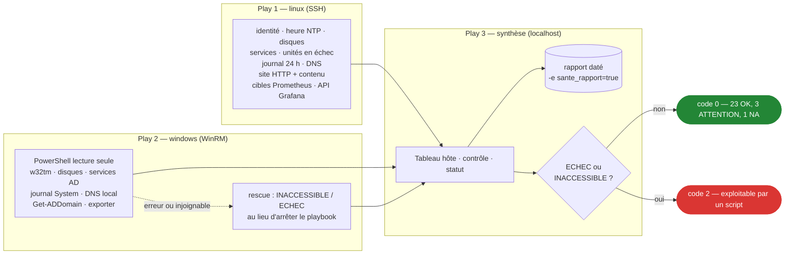

![[P-82-rendu-tableau-controle-sante.png|760]]

> [!note] Rendus de sorties
> Les images dont le nom contient `rendu` mettent en forme une **sortie de commande réelle**, dont le texte intégral est dans la preuve `.txt` indiquée en haut de l'image. Les autres images sont des captures d'écran de Prometheus, Grafana ou GitHub.

## 2. Supervision : collecte et tableau de bord

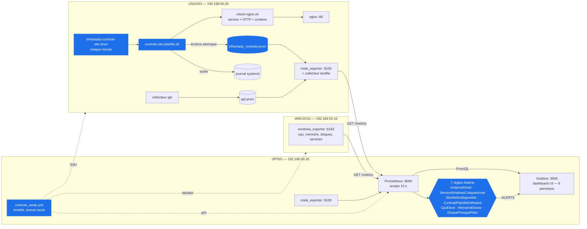

![[P-81-prometheus-cibles-up.png|700]]

![[P-85-grafana-dashboard-v3-exploitation.png|760]]

## 3. Tâche planifiée et alertes testées

![[P-83-rendu-timer-journal-metriques.png|760]]

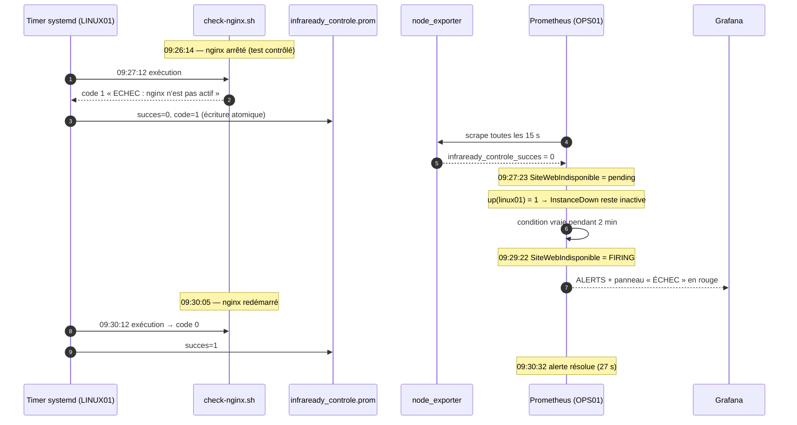

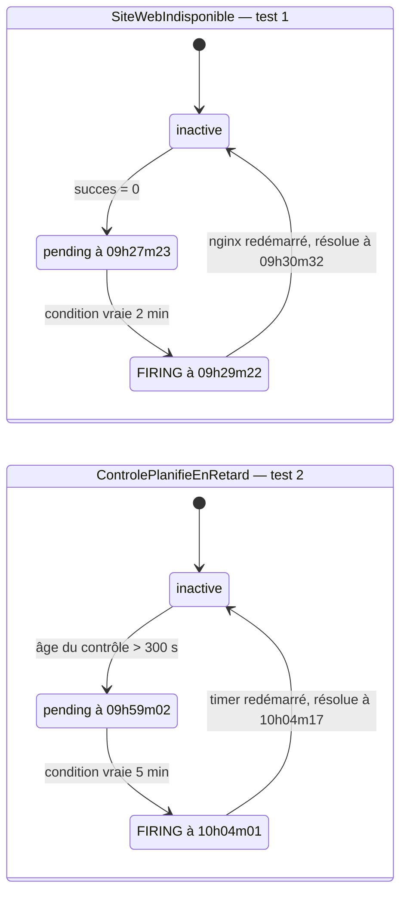

**Test 1 — nginx arrêté sur LINUX01 (09:26 → 09:30)** : le contrôle passe en ÉCHEC, `SiteWebIndisponible` déclenche à +3 min 08, alors qu'`InstanceDown` reste muette puisque le serveur est toujours en ligne.

![[P-84-grafana-dashboard-site-en-echec.png|760]]

![[P-84-prometheus-historique-controle-succes.png|700]]

**Test 2 — timer arrêté (09:54 → 10:04)** : plus aucun contrôle, `ControlePlanifieEnRetard` déclenche après 10 min sans résultat, puis se résout 11 s après le redémarrage du timer.

![[P-84-grafana-dashboard-controle-en-retard.png|760]]

## 4. Incident INC-2026-10-23-01 : arrêt brutal du contrôleur de domaine

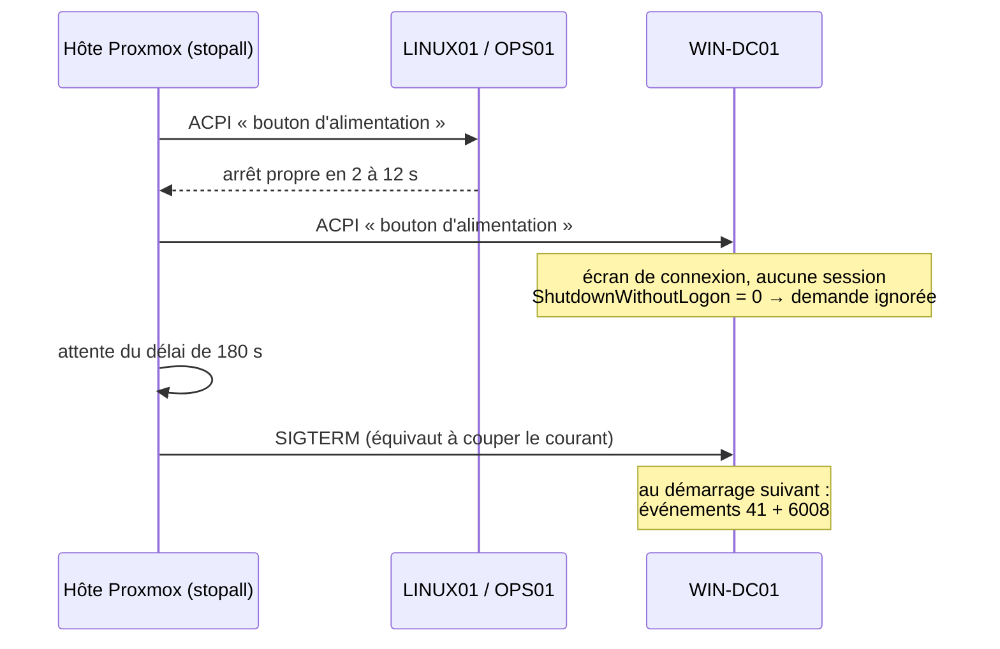

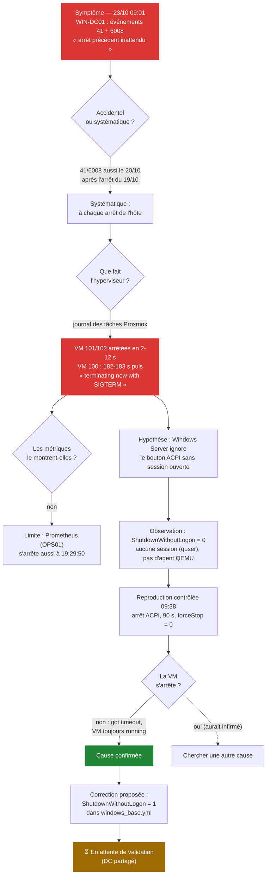

![[P-80-rendu-win-dc01-evenements-arret.png|760]]

![[P-86-rendu-proxmox-arrets-vm100-reproduction.png|760]]

> [!warning] Correction préparée, pas encore appliquée
> Cause : `ShutdownWithoutLogon = 0`, la valeur par défaut de Windows Server, fait ignorer la demande d'arrêt de Proxmox ; la VM est tuée au bout de 180 s. Correction proposée : passer la valeur à 1 via `windows_base.yml`. Elle modifie le DC partagé et attend la validation de l'équipe. Rapport complet : [[rapport-incident]].

## 5. Maintenance, tendance et quotas

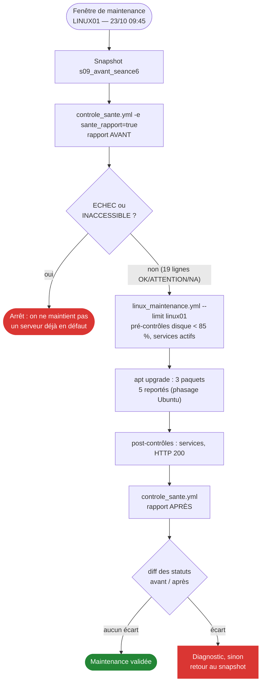

![[P-87-rendu-maintenance-avant-apres.png|760]]

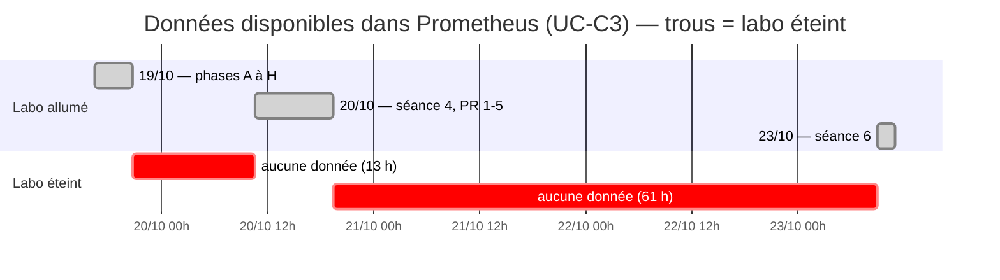

![[P-88-grafana-evolution-stockage-19-23-oct.png|760]]

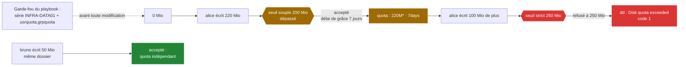

![[P-89-rendu-test-quotas-alice.png|760]]

## 6. Livraison : PR et intégration continue

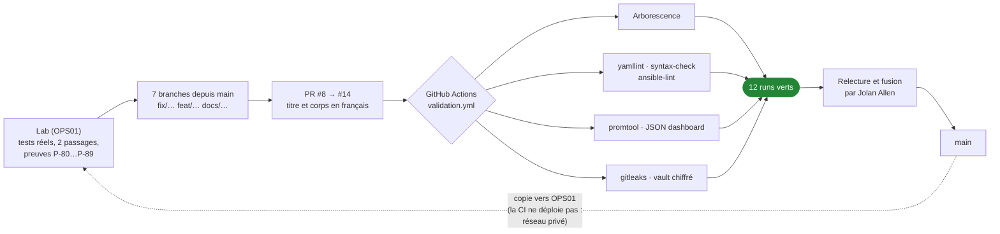

![[P-64-github-pr-seance6-fusionnees.png|700]]

![[P-64-github-actions-runs-verts.png|700]]

## Reste à faire

- [ ] Valider puis appliquer la correction de l'arrêt du DC (UC-05) et rejouer le test d'arrêt.
- [ ] Révoquer le jeton API Proxmox utilisé pendant la séance.
- [ ] Décider du démarrage automatique des VM avec l'hôte (`onboot`).
